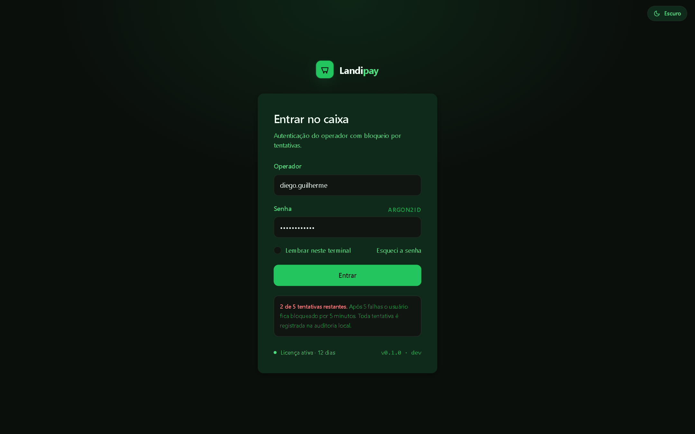
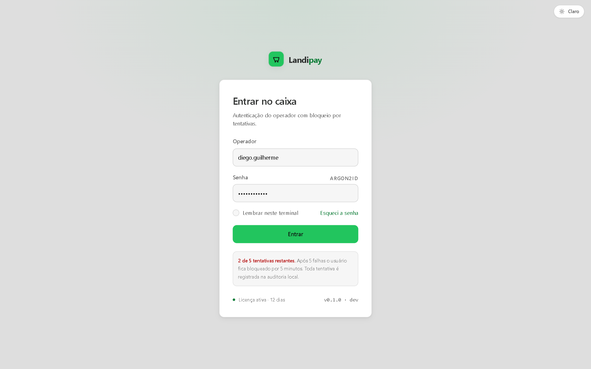
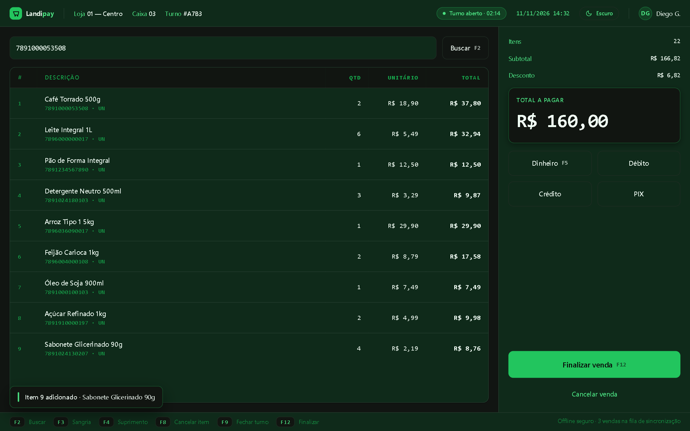
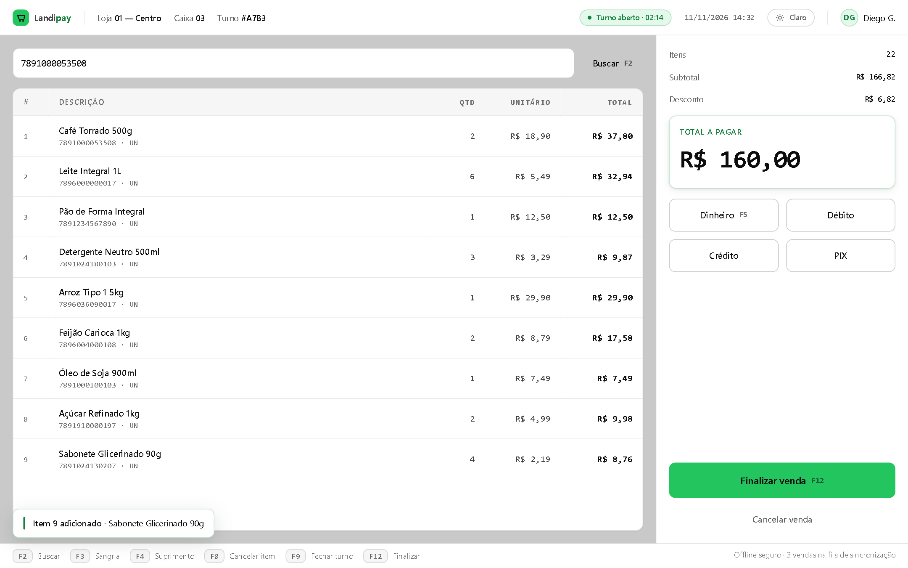
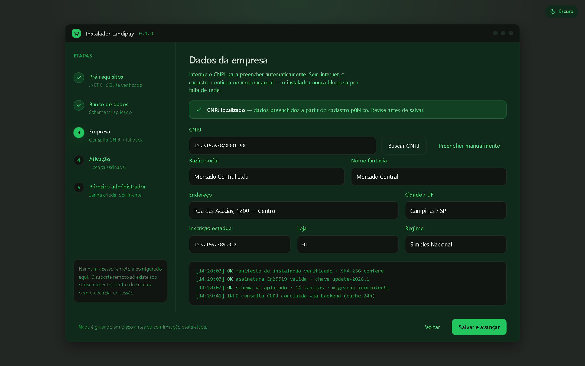
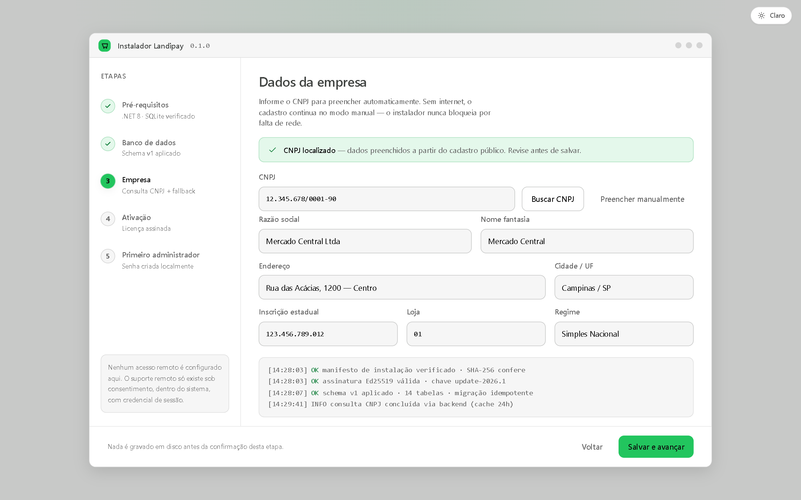
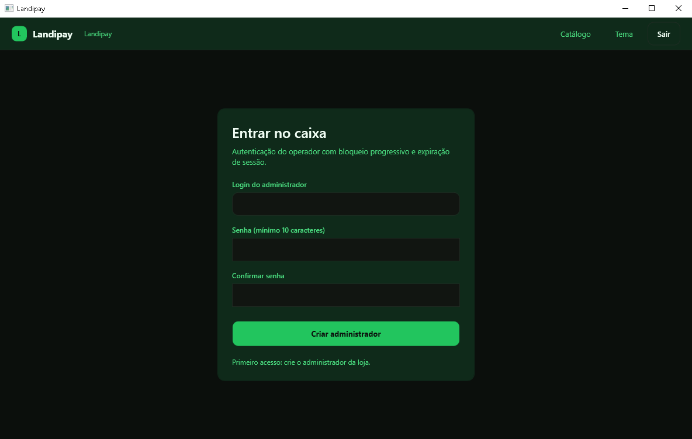
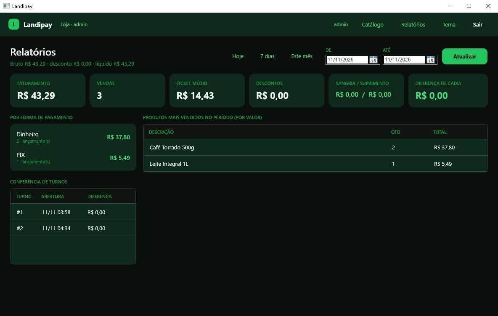

# Landipay

PDV desktop para lojas de varejo — cliente WPF offline-first, backend de licença e atualização verificada, e suporte remoto apenas sob consentimento.

> Projeto construído do zero como **substituto seguro** de um instalador legado analisado por engenharia reversa. Nenhum código, token, senha, endpoint ou binário do fornecedor original é reutilizado — apenas o comportamento funcional foi usado como especificação, e cada anti-padrão identificado no legado está mapeado para um controle aqui (ver seção *Contrato de segurança*).

**Status atual: Fases 0–5 concluídas + empacotamento MSI. Instalador de provisionamento, cliente WPF, backend de licença/update, relatórios por período, auditoria de segurança com evidência e pacote `.msi` (110 arquivos, atalhos, desinstalador) — instalado e desinstalado de verdade nesta máquina. 108 testes verdes, 13 documentos em `docs/`.**

## Screenshots

Tema escuro (padrão) e tema claro, renderizados em navegador real a 1440×900, 100% dirigidos por tokens:

| Tela | Escuro (padrão) | Claro (opção) | Lado a lado |
|---|---|---|---|
| Login |  |  | [compare](docs/mockups/login-compare.png) |
| Frente de caixa |  |  | [compare](docs/mockups/pdv-compare.png) |
| Instalador |  |  | [compare](docs/mockups/installer-compare.png) |

E o aplicativo WPF **real**, executado (não é mockup):



---

## Estrutura

```
landipay/
├── README.md
├── design/
│   └── tokens.json              ← fonte única de verdade do design system
├── docs/
│   ├── 00-arquitetura.md        ✅ Fase 0
│   ├── 01-modelo-dados.md       ✅ Fase 1
│   ├── 02-backend.md            ✅ Fase 2
│   ├── 03-cliente.md            ✅ Fase 3
│   ├── 04-instalador.md         ✅ Fase 4
│   ├── 05-testes-seguranca.md   ✅ Fase 5
│   ├── 06-guia-operacao.md      ✅ Fase 5
│   ├── 07-design-system.md      ✅ Fase 0
│   └── mockups/
│       ├── tokens.css           ← derivação web de design/tokens.json
│       ├── login.html / .png
│       ├── pdv.html  / .png
│       ├── installer.html / .png
│       ├── app-*.png             ← telas reais do cliente (Fase 3)
│       └── instalador-*.png      ← telas reais do instalador (Fase 4)
├── assets/
│   └── gerar-assets.py          ← deriva da logo oficial: .ico, PNGs por tema, marca do app
├── packaging/                    ✅ distribuição
│   ├── Package.wxs              ← definição do MSI (WiX 5, perUser, x64)
│   ├── build-msi.ps1            ← publish + strip .pdb + wix build
│   ├── licenca.rtf              ← termo exibido no assistente
│   └── payload/                 ← binários publicados que entram no MSI
├── dist/
│   └── Landipay-1.0.0.msi       ← 17,1 MB · SHA-256 833CD1BD…77DBB
└── src/                          ✅ Fases 1–4
    ├── Landipay.Domain/          entidades, invariantes, enums, value objects
    ├── Landipay.Infrastructure/  DbContext EF Core, migrations, factory design-time
    ├── Landipay.Updates/         manifesto assinado (Ed25519) + validador do cliente
    ├── Landipay.Backend/         serviços: licença ES256, update, CNPJ, suporte
    ├── Landipay.Api/             host Minimal APIs (ASP.NET Core 8)
    ├── Landipay.Client/          regras sem UI: auth, sessão, caixa, updater, prefs, instalador
    ├── Landipay.Theme/           design system compartilhado (tokens + componentes WPF)
    ├── Landipay.Desktop/         WPF (MVVM) — login, caixa, catálogo, temas
    └── Landipay.Installer/       WPF — 5 passos idempotentes de provisionamento + auditoria
└── tests/
    ├── Landipay.Tests/           68 testes (domínio, backend, cliente, instalador, relatórios)
    └── Landipay.Desktop.Tests/    4 testes (fluxo de primeiro acesso e login)
```

---

## Índice de documentação

| Doc | Conteúdo | Estado |
|---|---|---|
| [00 — Arquitetura](docs/00-arquitetura.md) | Componentes, fronteiras de confiança, stack, comparativo herdado→Landipay (A1–A6), STRIDE, cadeia de suprimentos, ADRs | ✅ |
| [07 — Design System](docs/07-design-system.md) | Tokens, tipografia, espaçamento, componentes, contraste medido (WCAG), acessibilidade, 3 mockups | ✅ |
| [01 — Modelo de dados](docs/01-modelo-dados.md) | ER, dicionário, índices, integridade em 3 camadas, migrations, prova de parametrização | ✅ |
| [02 — Backend](docs/02-backend.md) | Endpoints, licença ES256 com `kid`, manifesto assinado, CNPJ com cache, suporte opt-in | ✅ |
| [03 — Cliente](docs/03-cliente.md) | Módulos, autenticação Argon2id, sessão, updater, logging opt-in, tema | ✅ |
| [04 — Instalador](docs/04-instalador.md) | Passo a passo, verificação, offline, ativação, idempotência | ⏳ |
| [05 — Testes e segurança](docs/05-testes-seguranca.md) | Unit/integration, testes do validador de update, checklist | ⏳ |
| [06 — Guia de operação](docs/06-guia-operacao.md) | Instalar, atualizar, suporte, backup | ⏳ |
| [08 — Referência e gaps](docs/08-referencia-e-gaps.md) | Inventário da pasta REFERENCIA (Gestor/SyntaxPlus), gap analysis por domínio de PDV, priorização P0–P3 e tarefas com gate | ✅ |
| [00 — Análise reversa](docs/00-analise-reversa.md) | Telas observadas, modelo de dados inferido, catálogo A1–A6 com decisão, mapa de fluxos; evidências em `docs/_evidence/` | ✅ |
| [05 — MSI](docs/05-msi.md) | SHA-256 do MSI, como gerar, conteúdo instalado, ciclo instalar/desinstalar, pontos de atenção | ✅ |
| [07 — Inferências](docs/07-inferencias.md) | Tudo que não foi provado por execução, marcado como `(inferência)` | ✅ |
| [Índice dos mockups](docs/mockups/INDEX.md) | Origem de cada PNG: captura real da aplicação × mockup HTML | ✅ |

---

## Ver os mockups (sem build)

Não é necessário compilar nada na Fase 0:

```bash
# abrir no navegador (Windows)
start docs/mockups/login.html
start docs/mockups/pdv.html
start docs/mockups/installer.html
```

Os `.png` em `docs/mockups/` têm duas origens e o [índice dos mockups](docs/mockups/INDEX.md)
diz qual é qual: **capturas reais da aplicação em execução** (as usadas como prova de tela, com
barra de título do Windows) e **renders dos HTMLs acima** (estudo de design, marcados como
mockup). Nenhuma imagem é apresentada como captura de execução sem ser.

---

## Contrato de segurança (o que não pode regredir)

| # | Anti-padrão do legado | Controle Landipay | Onde |
|---|---|---|---|
| A1 | Senha fixa de acesso remoto embutida no binário | Credencial por sessão, opt-in, TTL 30 min, auditoria | `Assist` (Fase 2) |
| A2 | Tokens Basic/Bearer hardcoded | Secret store no servidor; cliente nunca fala com terceiros com chave própria | Fase 2 |
| A3 | Download e execução sem verificação | Manifesto assinado Ed25519 + SHA-256 + `kid` rotativo; recusa e audita | Fase 2/3 |
| A4 | Connection string concatenada + SQL interpolado | Config externa + 100% queries parametrizadas | Fase 1 |
| A5 | "Login" que não autentica | Argon2id, lockout progressivo, timeout de sessão, autorização por papel | Fase 2/3 |
| A6 | Logs enviados sem consentimento/criptografia | Log local-first + envio opt-in + TLS 1.3 + anonimização | Fase 3 |

Detalhamento, riscos residuais e modelo de ameaças: [docs/00-arquitetura.md](docs/00-arquitetura.md) (seção 6).

---

## Pré-requisitos (para a Fase 1 em diante)

| Requisito | Versão | Observação |
|---|---|---|
| .NET SDK | **8.0.428** | ✅ instalado em `C:\Program Files\dotnet` (11/11/2026). `dotnet --version` → `8.0.428` |
| dotnet-ef | **8.0.34** | ✅ instalado como tool global em `%USERPROFILE%\.dotnet\tools` |
| Windows | 10/11 | WPF é Windows-only (decisão LD-02) |
| PostgreSQL | 16 | Apenas para rodar o backend localmente |
| Node | — | Não é usado |

Cadeia de build verificada nesta máquina (comandos executados de verdade, não exemplos):

```bash
dotnet build -v q --nologo                    # 0 errors, 0 warnings
dotnet build -c Release                       # 13 projetos (11 de produção + 2 de teste), 0 erros, 0 avisos
dotnet test  -c Release                       # Aprovado: 108, Falha: 0  (102 + 6)
dotnet test tests/Landipay.Desktop.Tests -v q --nologo   # Aprovado: 4, Falha: 0
dotnet ef migrations add InitialCreate -p src/Landipay.Infrastructure -o Persistence/Migrations
dotnet ef database update -p src/Landipay.Infrastructure   # aplica no SQLite
```

Schema gerado (lido do banco, não estimado): 17 tabelas, 156 colunas, 28 índices (10 únicos),
19 check constraints, 17 FKs, 2 triggers de auditoria append-only.

Rodar a API (verificado nesta máquina):

```bash
export LANDIPAY_ADMIN_KEY="dev-admin-2026-test"        # obrigatória fora de Development
export ASPNETCORE_URLS="http://127.0.0.1:5080"
dotnet run --project src/Landipay.Api

# endpoints exercitados: /v1/saude, /v1/licencas, /v1/updates/manifesto,
# /v1/updates/chave-publica, /v1/suporte/sessoes, /v1/cnpj/{cnpj}
```

Rodar o cliente (WPF, Windows):

```bash
dotnet run --project src/Landipay.Desktop
# banco e logs em %APPDATA%\Landipay  (migrations aplicadas na primeira execução)
# perfil alternativo: LANDIPAY_DADOS="C:/caminho/perfil"
```

Rodar o instalador (WPF, Windows) — provisiona banco, empresa, licença e administrador:

```bash
export LANDIPAY_CHAVE_LICENCA="<chave publica ES256 em SPKI base64>"
export LANDIPAY_API="http://127.0.0.1:5080"
export LANDIPAY_LICENCA="<token emitido por POST /v1/licencas>"
dotnet run --project src/Landipay.Installer
```

Fluxo executado nesta máquina, duas vezes (instalação + reparo): schema aplicado e depois no-op,
empresa criada e depois atualizada, licença validada offline, administrador com Argon2id, 3 produtos
semeados uma única vez e quatro eventos em `LogAuditoria` por passagem. Telas em
`docs/mockups/instalador-*.png`, detalhes em [docs/04-instalador.md](docs/04-instalador.md).

Relatórios por período (Fase 5): botão **Relatórios** no cliente, com recorte Hoje / 7 dias /
Este mês ou datas livres. Entrega faturamento, vendas (com canceladas), ticket médio, descontos,
sangria/suprimento, diferença de caixa, quebra por forma de pagamento, top produtos e conferência
de turnos — todos somados no serviço, com 8 testes fixando número esperado.


Regerar os ativos de marca a partir das logos oficiais (fundo branco → transparente, `.ico`
multi-tamanho, variantes para tema claro e escuro):

```bash
python assets/gerar-assets.py
# → src/Landipay.Theme/Assets/{app.ico, icone-256.png, logo-*-escuro/claro.png}
```

Gerar o pacote de distribuição (MSI):

```powershell
powershell -NoProfile -ExecutionPolicy Bypass -File packaging\build-msi.ps1
# → dist\\Landipay-1.1.0.msi  (17,9 MB · 110 arquivos · 0 .pdb)

msiexec /i dist\\Landipay-1.1.0.msi          # instala por usuário, sem administrador
msiexec /x dist\\Landipay-1.1.0.msi /qn      # desinstala e preserva %APPDATA%\\Landipay
# SHA-256: 180B85957701365F09CBA145C37F284FB091364A97BCCEFC6DC87A46BB701A20
```

Verificado nesta máquina em 11/11/2026: instalação **exit 0** com **110 arquivos** em
`%LOCALAPPDATA%\\Landipay`, 2 atalhos na área de trabalho + 3 no menu iniciar, entrada
`Landipay PDV 1.1.0` em "Programas e Recursos" registrada em **x64** (não em `WOW6432Node`),
desinstalação **exit 0** sem tocar em `%APPDATA%\\Landipay\\landipay.db`. Detalhes, hashes e
logs em [docs/05-msi.md](docs/05-msi.md); decisões de instalador em
[docs/04-instalador.md](docs/04-instalador.md) §10.

Build, run e testes serão documentados aqui **com comandos reais e verificados** ao fim de cada fase — nenhum comando placeholder fica neste README.

---

## Integração contínua

`.github/workflows/ci.yml` roda em `windows-latest` a cada push/PR na `main`:

```bash
dotnet restore Landipay.sln --nologo
dotnet build   Landipay.sln -c Release --no-restore --nologo -warnaserror
dotnet test    tests/Landipay.Tests         -c Release --no-build --logger "trx;LogFileName=unitarios.trx" --results-directory TestResults/unitarios
dotnet test    tests/Landipay.Desktop.Tests -c Release --no-build --logger "trx;LogFileName=fluxo-ui.trx" --results-directory TestResults/fluxo-ui
```

Os dois `dotnet test` são **separados de propósito**: o nome padrão do `.trx` é `<usuário>_<máquina>_<timestamp com segundos>`, então dois assemblies iniciados no mesmo segundo gravam o mesmo arquivo e um apaga o resultado do outro.

- `-warnaserror`: o projeto está em 0 avisos; se voltar a ter, o gate trava antes de virar dívida.
- **Gate de contagem:** um passo em PowerShell soma os `.trx` e falha se não forem `TESTES_ESPERADOS` (108) com 0 falhas — "passo verde" passa a significar "108 testes rodaram e passaram", não só "o comando saiu 0". Ao adicionar testes, atualize a variável de ambiente no topo do workflow.
- Os `.trx` e o `resultado.txt` sobem como artefato `resultados-testes`; o resumo da suíte aparece no *Summary* do run.
- **Primeiro run verde:** [CI #1 — 2min24s](https://github.com/diegotecnico2982002-hue/landipay/actions/runs/43075014767) (checkout, .NET 8, cache, restore, build, testes, artefato: todos `success`).
- **Run com o gate de contagem:** [CI #2 — 2min38s](https://github.com/diegotecnico2982002-hue/landipay/actions/runs/43076518139) — o passo *Conferir contagem da suíte* passou no runner, ou seja, **contagem da suíte (hoje 108) e 0 falhas foi verificado pela própria máquina do GitHub**, não por mim.
- **Incidente registrado:** o [run #3](https://github.com/diegotecnico2982002-hue/landipay/actions/runs/43077134173) **falhou** com o passo de testes verde e a contagem em 90 — o segundo assembly sobrescreveu o `.trx` do primeiro, pela colisão de nome descrita acima. É o gate funcionando: sem ele, o verde teria escondido um relatório de 90 testes. Corrigido com nome de arquivo e pasta por assembly.
- O que o pipeline **não** faz: gerar/assinar o MSI e rodar a varredura de segredos. Cada um tem sua tarefa em [docs/08](docs/08-referencia-e-gaps.md) (P0-9/P0-10 e a varredura de `docs/05` §3).

---

## Convenções do projeto

1. **Zero segredo no binário.** ✅ Executado: 116 arquivos / 77,8 MB varridos no publish Release, 0 achados, com controle positivo provando que o detector funciona ([docs/05](docs/05-testes-seguranca.md) §3).
2. **Zero cor literal na UI.** Cores só via `design/tokens.json` → `tokens.css` / `Theme.Landipay.xaml`.
3. **Zero SQL concatenado.** Queries parametrizadas ou EF Core; string SQL montada à mão falha na revisão.
4. **Toda ação sensível gera auditoria.** Login, abertura/fechamento de caixa, cancelamento, suporte remoto.
5. **Nenhum artefato de rede executa sem hash + assinatura validados.**
6. **Decisão sem herança declarada é marcada como "decisão nova"** nos docs (ver LD-01…LD-06 em `00-arquitetura.md`).


## Como rodar os dois aplicativos

O Landipay é **dois executáveis**, com backend e banco compartilhados:

| Executável | Para quê | Atalho |
|---|---|---|
| `Landipay.Admin.exe` | gestão: cadastros, relatórios, usuários, configurações, licença | "Landipay Admin" |
| `Landipay.Pos.exe` | frente de caixa: venda, pagamento, sangria/suprimento, turno | "Landipay Caixa" |

```bash
# build (13 projetos: 11 de produção + 2 de teste)
dotnet build

# executar direto do build
dotnet run --project src/Landipay.Admin
dotnet run --project src/Landipay.Pos
```

Por permissão: **OperadorCaixa** entra apenas no Caixa; **Admin** entra apenas no Admin;
**Gerente** entra nos dois. Quem tenta o app errado é recusado na tela e o evento `acesso.negado`
fica no `LogAuditoria` — a regra vale também para quem chamar o serviço diretamente.

### Papéis num banco já existente

```bash
# cria permissões/papéis e concede o papel ao login (idempotente)
dotnet run --project tools/preparar-acesso -- --admin admteste
dotnet run --project tools/preparar-acesso -- --caixa operador
dotnet run --project tools/preparar-acesso -- --gerente fulano
```

### Instalador (passo 6)

Depois da licença e da senha do administrador, o instalador pergunta **quais aplicativos esta
estação pode abrir** (Admin / Caixa / Ambos), grava `apps.json` no diretório de dados e audita
`instalacao.aplicativos`. Reexecutar o instalador troca a escolha sem duplicar nada.

### Escopo de aplicativos na licença

`POST /v1/licencas` aceita `apps`:

```bash
curl -X POST http://127.0.0.1:5080/v1/licencas   -H "X-Admin-Key: $LANDIPAY_ADMIN_KEY" -H "Content-Type: application/json"   -d '{"empresaId":"<guid>","instalacaoId":"loja-01","plano":"pro","apps":["pos"]}'
```

Sem `apps`, a licença habilita os dois. Com `["pos"]`, o passo 6 do instalador desabilita o
App Admin e recusa a escolha fora do escopo (auditado).

### Screenshots

| Tela | Escuro | Claro |
|---|---|---|
| Login Admin | `docs/mockups/admin-login-escuro.png` | `docs/mockups/admin-login-claro.png` |
| Login Caixa | `docs/mockups/pos-login-escuro.png` | `docs/mockups/pos-login-claro.png` |
| Dashboard Admin | `docs/mockups/admin-dashboard-escuro.png` | `docs/mockups/admin-dashboard-claro.png` |
| Frente de caixa | `docs/mockups/pos-caixa-escuro.png` | `docs/mockups/pos-caixa-claro.png` |
| Acesso negado | `docs/mockups/acesso-negado-escuro.png` | `docs/mockups/acesso-negado-claro.png` |
| Instalador — seleção de app | `docs/mockups/installer-aplicativos.png` | `docs/mockups/installer-aplicativos-claro.png` |

### Estado e pendências

- Build: 13 projetos, 0 erros, 0 avisos (o CI roda com `-warnaserror`).
- Testes: **108 verdes** (`dotnet test`: 102 em `Landipay.Tests` + 6 em `Landipay.Desktop.Tests`).
- Pendências para uso comercial: fiscal (NFC-e/SAT/DANFE), TEF/POS/Pix, consumo da outbox,
  backup/restore, impressão de cupom, exportação, assinatura de binários — e, desta correção:
  **JWT de sessão na API** (com `perms`/`app`), **claim `apps` na licença** e **manifesto de update
  com hash por pacote**.

