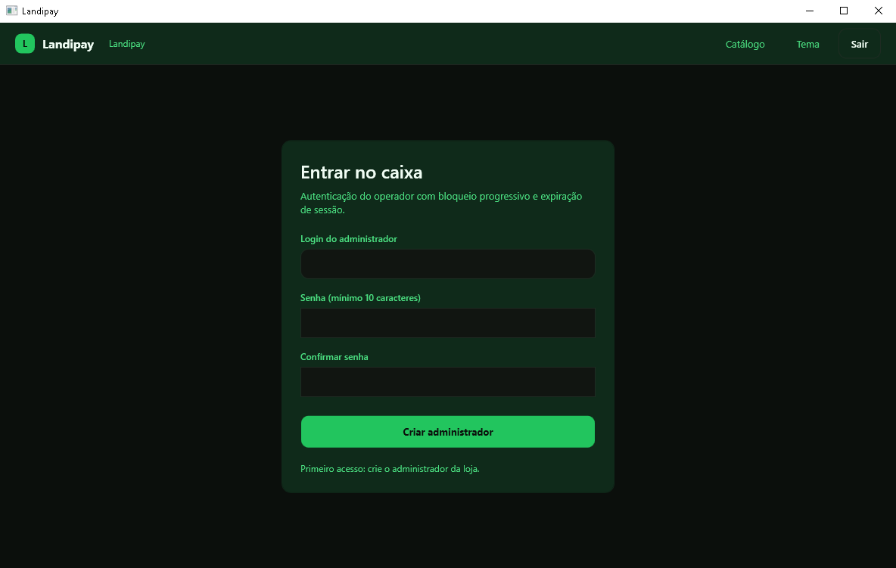
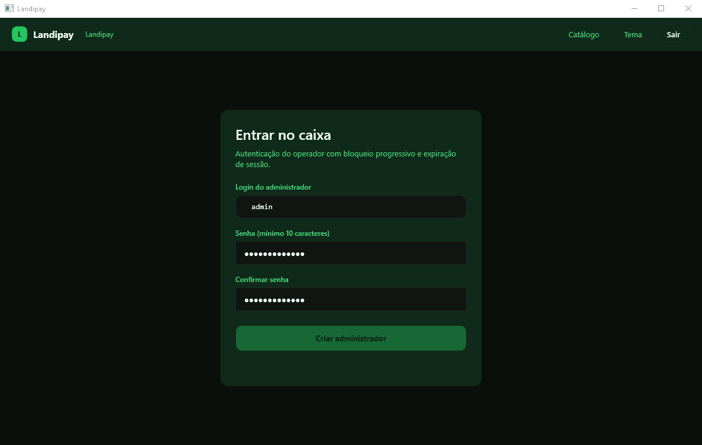
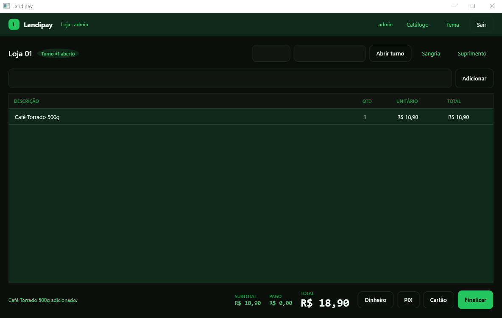
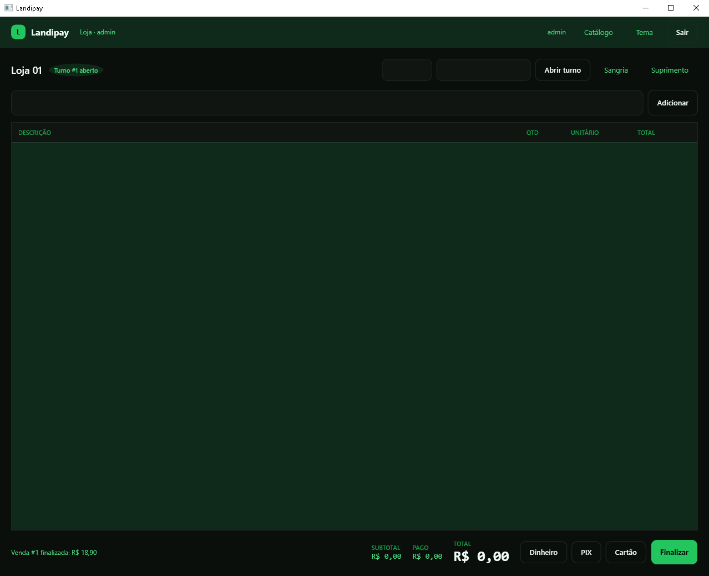
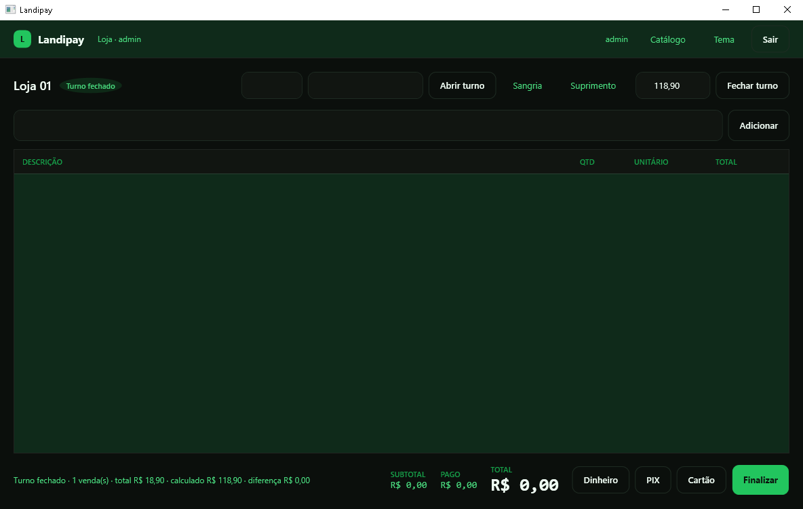
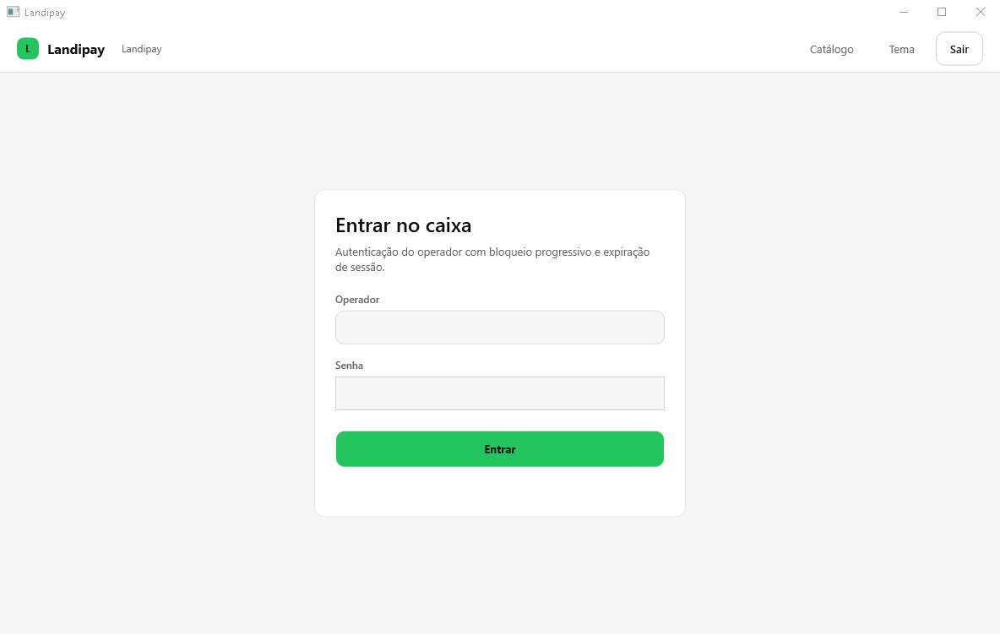
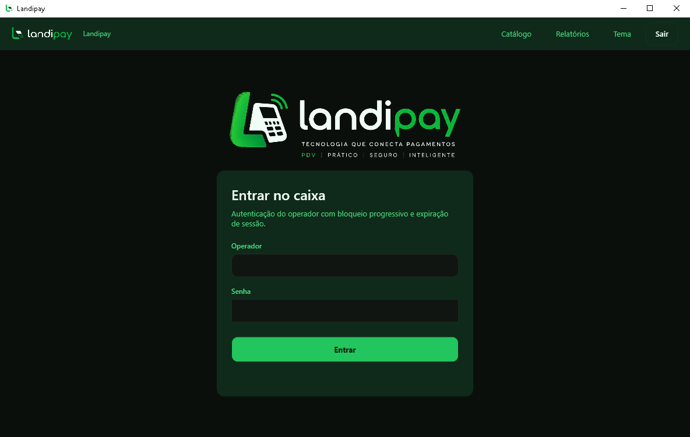
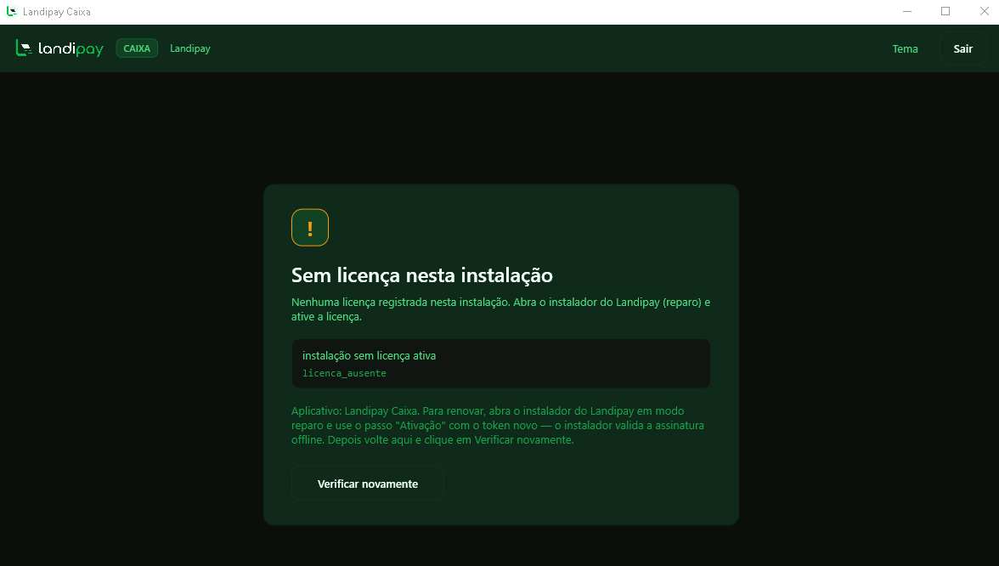

# 03 — Cliente desktop (WPF)

> Documento da Fase 3. Estado: **concluída** — app compila e abre, 47 testes verdes (16 novos desta fase), login renderizado a partir do binário real.
> Código: `src/Landipay.Client` (regras sem UI) e `src/Landipay.Desktop` (WPF/MVVM).

---

## 1. Objetivo

Entregar o caixa de verdade, sem herdar a lógica de "login que não autentica", o updater cego e o log enviado sem consentimento.

A separação em dois projetos é deliberada:

| Projeto | TFM | Papel |
|---|---|---|
| `Landipay.Client` | `net8.0` | autenticação, sessão, operação de caixa, updater, preferências, opt-in de log — **testável sem UI** |
| `Landipay.Desktop` | `net8.0-windows` + WPF | apenas ViewModels finos, XAML e composição |

Consequência prática: 16 dos testes desta fase rodam sem abrir janela, o que permite provar regra de negócio em CI headless.

---

## 2. Autenticação (A5)

| Item | Implementação |
|---|---|
| Hash | **Argon2id**, m=64 MB, t=3, p=4, salt 16 B, saída 32 B, PHC string |
| Verificação | `CryptographicOperations.FixedTimeEquals` — nunca `==` em hash |
| Lockout | 5 falhas → 5 min; 10 falhas → 30 min (regra no domínio, `Usuario`) |
| Sessão | inatividade 15 min + absoluto 12 h, ambos independentes |
| Enumeração de contas | usuário inexistente e senha errada devolvem **o mesmo** `credenciais_invalidas` |
| Auditoria | `login.ok` e `login.falha` (com motivo e contador) em `LogAuditoria` |
| Primeiro acesso | tela cria o administrador com senha digitada (mín. 10 caracteres). **Não existe senha padrão embutida** |

Provas automatizadas: PHC válido e salt diferente a cada hash; senha errada não passa; 5 falhas bloqueiam **mesmo com a senha correta**; após 6 min a senha correta volta a funcionar; usuário inexistente devolve o mesmo código; sessão expira por inatividade e é encerrada na ação seguinte.

---

## 3. Módulos

### 3.1 Caixa (frente de venda)

Fluxo implementado no `ServicoDeCaixa`:

```
abrir turno (valor de abertura)
  └─ venda (número sequencial por loja)
       ├─ adicionar item (código de barras / SKU)
       ├─ registrar pagamento (Dinheiro, PIX, Cartão)
       └─ finalizar
             ├─ valida pagamento >= total
             ├─ baixa estoque (recusa saldo insuficiente, com o nome do produto)
             ├─ grava Outbox (sincronização com a nuvem)
             └─ grava auditoria
sangria / suprimento (com motivo obrigatório)
fechamento de turno (calculado x informado, com diferença)
```

**Troco tratado de verdade:** o fechamento soma o dinheiro **menos o troco devolvido**. Uma venda de R$ 37,80 paga com R$ 40 entra como R$ 37,80 na gaveta, não R$ 40 — teste dedicado cobre exatamente esse caso.

### 3.2 Catálogo / estoque

Lista de produtos com SKU, nome, preço e **saldo atual** por loja, filtrável. O saldo é calculado somando os movimentos (entrada, saída, ajuste, perda, devolução) — ver limitação 4.

No primeiro acesso, `CatalogoDemo` semeia **3 produtos com estoque inicial** (café 500 g/20 un, leite 1 L/60 un, arroz 5 kg/15 un) para o caixa poder ser operado imediatamente. É idempotente (não duplica catálogo) e é dado de demonstração, não fiscal — o instalador (Fase 4) pode reaproveitar o mesmo componente com o catálogo real.

### 3.3 Telas entregues

| Tela | View | Estado |
|---|---|---|
| Login / primeiro acesso | `LoginView.xaml` | ✅ |
| Frente de caixa | `CaixaView.xaml` | ✅ |
| Catálogo | `ProdutosView.xaml` | ✅ |

---

## 4. Updater (A3)

`AtualizadorDesktop` executa a ordem exigida e **para no primeiro erro**:

1. baixa o manifesto do backend;
2. valida **assinatura Ed25519** com a chave pública pinada;
3. checa `versao >= versaoMinima` e bloqueia downgrade;
4. confere igualdade de versão (não baixa à toa);
5. baixa o artefato;
6. confere **SHA-256** contra o hash assinado;
7. só então grava o arquivo na pasta de staging.

**O serviço nunca chama `Process.Start`.** Aplicar o pacote é passo separado e explícito — a fase de instalador (Fase 4) é quem executa, com o mesmo manifesto.

Provas: manifesto com assinatura de outra chave → recusa **e não faz download** (contador de downloads = 0); arquivo com hash divergente → recusa e **não grava nada**; tudo válido → grava e reporta o caminho.

---

## 5. Logging (A6)

- **Serilog** com sink de arquivo local, rotação diária, retenção de 30 dias, em `%APPDATA%\Landipay\logs`.
- Envio é **opt-in**, e o `EnvioDeLogOptIn` aplica três travas antes de qualquer byte sair: preferência ligada pelo usuário, endpoint **HTTPS** obrigatório, arquivo existente. Sem opt-in, retorna `false` sem tocar a rede (testado com contador de chamadas = 0).
- Nenhum log registra senha, hash ou token.

---

## 6. Tema (design system aplicado)

```
Themes/Theme.Dark.xaml   ← tokens do tema escuro (padrão)
Themes/Theme.Light.xaml  ← mesmas chaves, valores claros
Themes/Componentes.xaml  ← estilos: nenhuma cor literal, só DynamicResource
```

- Troca em runtime: `App.AplicarTema` substitui `MergedDictionaries[0]`; como todo componente usa `DynamicResource`, a janela repinta **sem reiniciar** (botão "Tema" na barra superior).
- Persistência **por usuário** em `%APPDATA%\Landipay\preferences.json`; valor inválido volta para `dark` (testado).
- Botão primário usa `PrimaryForeground` escuro nos dois temas — a decisão C1 (8,53:1) vale no app real, não só no mockup.

---

## 7. Segurança no cliente

| Controle | Como |
|---|---|
| Sem elevação | `app.manifest` com `requestedExecutionLevel level="asInvoker"` — caixa não roda como administrador |
| Sem segredo no binário | nenhuma chave, token ou senha; o cliente só fala com a API do Landipay |
| Senha nunca logada | `PasswordBox` → ViewModel, e o log registra apenas o evento de login |
| Sessão expira | timeout de inatividade é verificado **antes de cada ação de caixa** (`SessaoValida()`), não apenas no login |
| Operações auditadas | abrir/fechar turno, venda, sangria e suprimento gravam `LogAuditoria` (append-only no banco) |

---

## 8. Prova de execução

```
dotnet build            → 9 projetos, 0 erros, 0 avisos
dotnet test             → Aprovado: 48, Falha: 0   (Client/API/Backend/Domain)
dotnet test tests/Landipay.Desktop.Tests → Aprovado: 4, Falha: 0   (fluxo de tela)
```

Aplicativo **executado** (não só compilado): abriu, aplicou a migration do SQLite em `%APPDATA%\Landipay\landipay.db`, detectou banco sem usuário e renderizou a tela de primeiro acesso no tema escuro:



### 8.1 Fluxo percorrido na UI real (executado, com captura)

O fluxo completo foi executado na janela real, com automação de UI, num **perfil de dados isolado** (`LANDIPAY_DADOS` apontando para pasta temporária) — o banco de uso diário não foi tocado:

| Passo | Ação | Resultado observado |
|---|---|---|
| 1 | Primeiro acesso: login `admin` + senha, "Criar administrador" | `Administrador criado. 3 produtos de demonstração no catálogo.` |
| 2 | Login com a senha recém-definida | abre a tela de caixa (`Loja 01 · Turno fechado`) |
| 3 | Abrir turno com 100,00 | chip muda para `Turno #1 aberto` |
| 4 | Bipar `7891000053508` | linha `Café Torrado 500g · 1 · R$ 18,90`; subtotal e total atualizados |
| 5 | Pagar em dinheiro | `Recebido R$ 18,90 em Dinheiro.`; PAGO = TOTAL |
| 6 | Finalizar | `Venda #1 finalizada: R$ 18,90` |
| 7 | Fechar turno informando 118,90 | `Turno fechado · 1 venda(s) · total R$ 18,90 · calculado R$ 118,90 · diferença R$ 0,00` |






Conferência no banco depois do fluxo:

```
Vendas:            #1 Finalizada
Estoque do café:   19  (era 20 — baixa de 1 unidade, produto rastreado)
Outbox:            1 mensagem (VendaFinalizada)
Auditoria:         login.ok → caixa.aberto → venda.finalizada → login.ok → caixa.fechado
CaixaTurnos:       #1 Fechado, valor calculado 118,90
```

### 8.2 Lacuna encontrada durante o teste e corrigida

Ao operar a tela, o `FecharTurnoCommand` existia no ViewModel mas **não havia botão** em `CaixaView.xaml` — ou seja, o turno abria e não fechava pela UI. Corrigido: campo de valor contado + botão "Fechar turno" na barra superior, no tema (`Lp.TextBox` / `Lp.Button.Secondary`). Só apareceu porque o fluxo foi executado de verdade; teste de ViewModel não pegaria falha de XAML.

### 8.3 Tema claro no app real
O botão "Tema" troca os dicionários em runtime — sem reiniciar, com a preferência salva:



### 8.4 Marca aplicada

A logo oficial entra em três lugares e em nenhum a mais: **cabeçalho** (identidade), **login**
(boas-vindas, com a assinatura "Tecnologia que conecta pagamentos") e **ícone** do executável,
da janela e dos atalhos.

O wordmark da marca é verde-escuro (`#0F3524`) e sumiria no fundo do produto, então existem duas
variantes — escura e clara — resolvidas por `DynamicResource`: alternar o tema troca a arte sem
código. O ícone leva uma placa clara atrás do símbolo, senão o paralelogramo desaparece em barra
de tarefas escura. Derivação reproduzível em `assets/gerar-assets.py`; regras no
[docs/07 §12](07-design-system.md).




---

## 9. O que mudou em relação ao legado

| Legado | Landipay | Anti-padrão |
|---|---|---|
| "Login" que só checava versão; qualquer senha entrava | Argon2id + lockout + timeout de sessão + auditoria | A5 |
| App rodava com privilégio alto para instalar banco | `asInvoker`; banco é SQLite embarcado | — |
| Updater executava o que baixava | valida assinatura + hash; nunca executa | A3 |
| Log com AnyDesk ID enviado ao fornecedor | log local; envio opt-in com TLS e aviso | A6 |
| Cores espalhadas pelo XAML | 100% por token, dois temas, troca em runtime | (design system) |

---

## 10. Limitações conhecidas

1. **Catálogo inicial é de demonstração** — 3 produtos semeados no primeiro acesso. Substituir por catálogo real é trabalho do instalador/importação (Fase 4).
2. **Updater baixa, não aplica** — por decisão de escopo. Aplicar (executar o instalador do pacote validado) é da Fase 4.
3. **Relatórios** hoje só o resumo de fechamento de turno (vendas, total, por forma de pagamento, sangrias/suprimentos, diferença). Relatórios por período entram na **Fase 5**, por decisão de escopo.
4. **Saldo de estoque calculado em memória** (soma de movimentos). Para catálogos grandes, a tabela de saldos materializada entra na Fase 5 — está registrado em `docs/01` §13.
5. **Um DbContext por sessão do app.** Suficiente para terminal único; se houver retaguarda escrevendo no mesmo banco, entra controle de concorrência otimista.


---

## Atualização — Dois entry points

**Estado:** implementado e executado (screenshots reais em `docs/mockups/`).

### Estrutura

| Projeto | Tipo | Responsabilidade |
|---|---|---|
| `Landipay.Ui` | biblioteca WPF | Views, ViewModels, `ComposicaoApp` |
| `Landipay.Admin` | WinExe | shell de gestão; `ComposicaoApp(Aplicativo.Admin)` |
| `Landipay.Pos` | WinExe | shell de caixa; `ComposicaoApp(Aplicativo.Pos)` |

`ComposicaoApp` decide: tema, serviços, `Shell`, tela inicial e escopo de login. O shell do Admin
mostra `Início · Catálogo · Relatórios · Tema · Sair`; o do Caixa mostra só `Tema · Sair`.

### Login por app

O mesmo `LoginViewModel` serve os dois, com texto próprio ("Entrar na gestão" / "Entrar no caixa")
e `Aplicativo` no construtor. Credencial válida em app não permitido:

> *"Seu perfil não tem acesso ao Landipay Caixa. A tentativa foi registrada na auditoria."*

e o registro `acesso.negado` aparece no `LogAuditoria` com `app`, `papeis` e `motivo`.

### Tela de acesso negado

`AcessoNegadoViewModel` + `AcessoNegadoView`: mostra a mensagem do serviço, explica que o evento foi
auditado e exibe o **código da permissão exigida**. É usada quando uma operação é barrada em sessão
válida (ex.: papel alterado no meio do turno) — não substitui a negativa de login.

### Fluxos documentados (mockups)

| Tela | Escuro | Claro |
|---|---|---|
| Login Admin | `admin-login-escuro.png` | `admin-login-claro.png` |
| Login Caixa | `pos-login-escuro.png` | `pos-login-claro.png` |
| Dashboard Admin | `admin-dashboard-escuro.png` | `admin-dashboard-claro.png` |
| Frente de caixa | `pos-caixa-escuro.png` | `pos-caixa-claro.png` |
| Acesso negado | `acesso-negado-escuro.png` | `acesso-negado-claro.png` |

Todos foram capturados do binário em execução (não são mockups desenhados). O tema é trocado pelo
botão `Tema` e persiste por usuário — o app abre no último tema usado.

### Updater com dois pacotes

Pendente: o manifesto assinado hoje cobre um pacote. O contrato para dois binários é `pacotes[]`,
cada um com `nome`, `sha256`, `versao` e assinatura própria, mantendo a regra A3 (validar antes de
gravar; nunca `Process.Start`).

---

## Atualização — Licença em operação (P0-3)

**O que estava errado:** a licença era validada **só no instalador** (`ServicoInstalador.AtivarLicenca`).
Depois de instalada, o app abria e vendia por tempo indeterminado — inclusive com licença vencida
ou revogada. O `docs/00 §6.1` prometia "validação a cada 12 h com janela offline de 7 dias"; o código
não fazia nada disso.

**O que existe agora:**

| Peça | Papel |
|---|---|
| `Landipay.Client.Seguranca.ServicoDeLicenca` | Avalia a licença e é a **porta de bloqueio** (`ExigirOperacao`). Estados: `licenca_ok`, `licenca_em_tolerancia`, `licenca_expirada`, `licenca_revogada`, `licenca_ausente`, `licenca_adulterada` |
| `ConfigLicenca.Reavaliar(agora)` (domínio) | Recalcula `Ativa/EmTolerancia/Expirada` pelo relógio, sem tocar em token nem em `ExpiraEm` |
| `ServicoDeCaixa` | Chama `ExigirOperacao` em **abrir turno, iniciar venda, finalizar venda, sangria e suprimento** |
| `ComposicaoApp` | Avalia na abertura e no login; quando bloqueada, a primeira tela é a de licença, não o login |
| `LicencaView` / `LicencaViewModel` | Explica o motivo, a data, os dias restantes e como renovar; botão **Verificar novamente** reavalia sem reabrir o app |

**Regras que ficaram explícitas (e testadas):**

- **Fechar turno continua funcionando com licença vencida.** O dinheiro já está na gaveta e a
  conferência precisa acontecer; bloquear aqui empurraria o operador a fechar por fora, sem rastro.
- **A tolerância offline não é renovada pela abertura do app.** `UltimaValidacaoEm` só muda em
  validação online (renovação pelo instalador). Se cada abertura atualizasse a data, a licença
  vencida nunca expiraria — o defeito que este controle corrige.
- **Data esticada no banco é adulteração.** O serviço lê o `exp` do próprio token (sem confiar na
  assinatura) e recusa quando o valor gravado é maior que o assinado.
- **Assinatura:** quando o `ServicoDeLicenca` recebe a chave ES256 pinada, a assinatura é conferida
  a cada avaliação. Hoje o app é montado **sem** chave pinada (`new ServicoDeLicenca(Db)`), e a tela
  declara isso ("assinatura não conferida (sem chave pinada)") em vez de esconder. Pinagem da chave
  pública + rotação por `kid` é o próximo passo (depende do KMS de produção).

**Aviso antes do vencimento:** a partir de 7 dias do vencimento o cabeçalho mostra
`Licença expira em N dia(s) — renove antes do vencimento.` (token `Lp.Brush.Warning`).

**Prova de execução (11/11/2026):** app Caixa compilado e aberto com diretório de dados vazio —
a janela abriu direto na tela de licença, com `licenca_ausente`, e o evento `licenca.ausente` ficou
no `LogAuditoria`:



**Testes:** 12 em `LicencaOperacionalTests` (serviço + caixa) e 2 em `LicencaNaAberturaTests`
(composição real do app) — suíte em 108.
