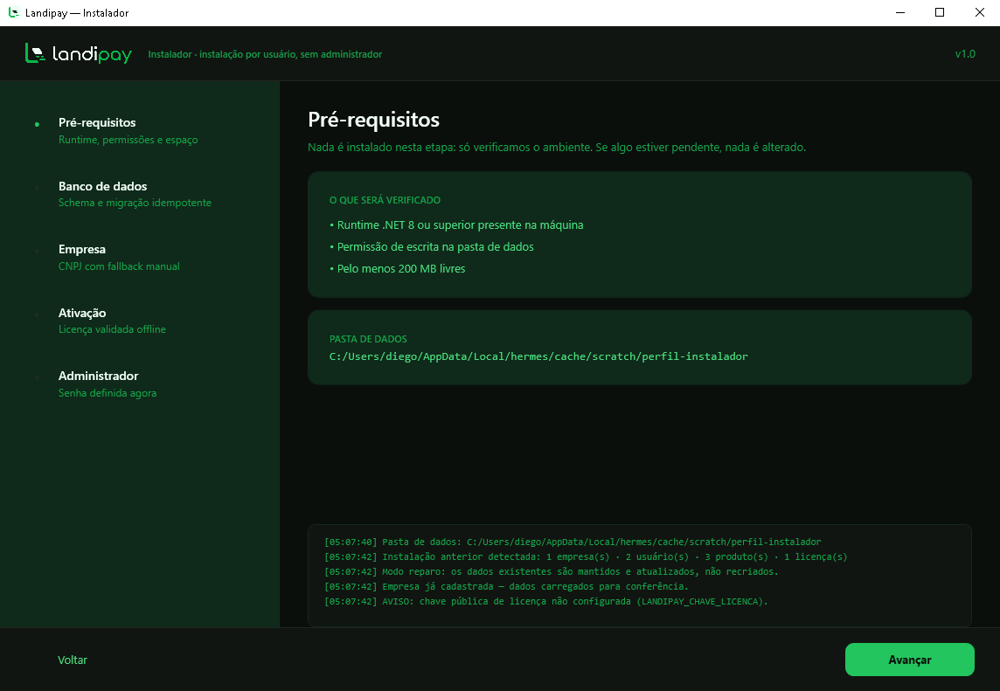
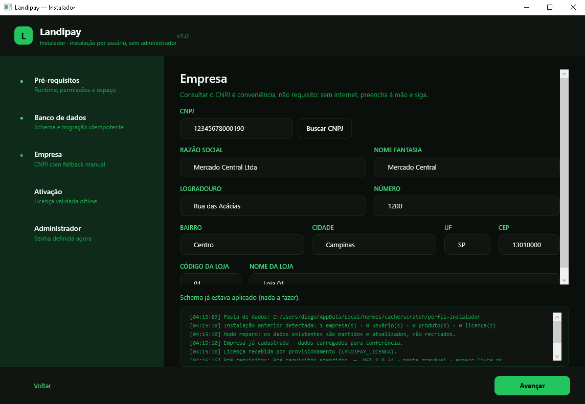
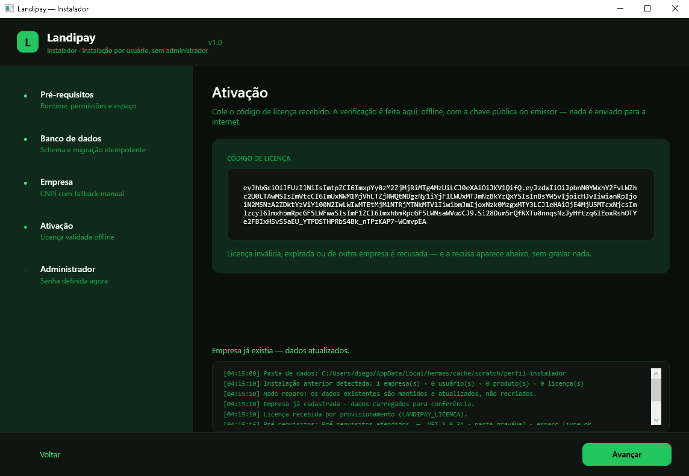
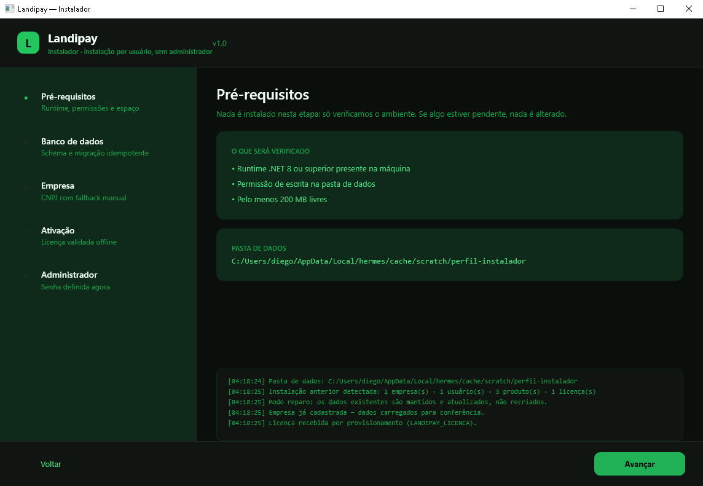
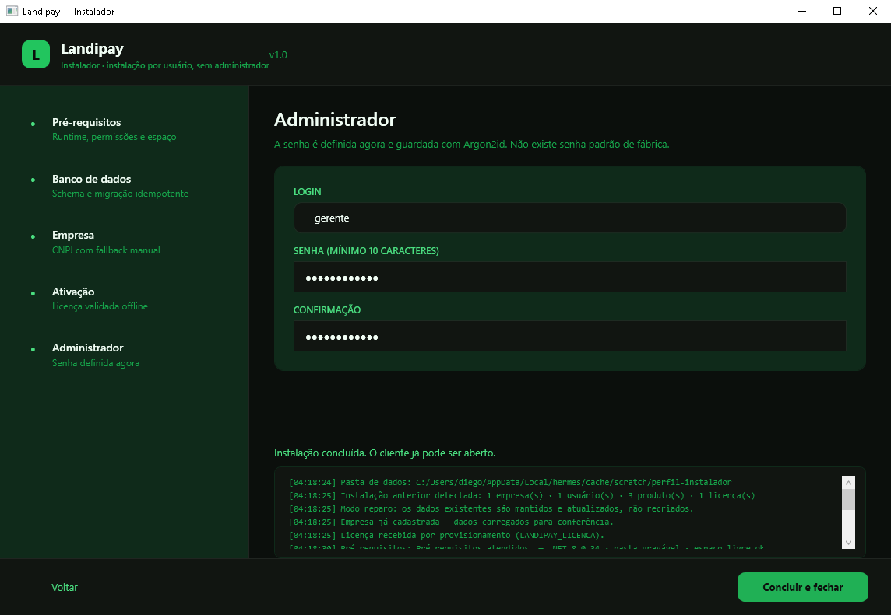

# 04 — Instalador Landipay

> Fase 4. O que este documento garante: o instalador **não baixa e executa nada**, **não instala
> engine de banco**, **não abre canal de acesso remoto** e **não cria senha padrão**. Ele prepara a
> máquina em cinco passos idempotentes, todos auditados, e funciona sem internet.

---

## 1. Fluxo

| # | Passo | O que faz | Falha bloqueia? |
|---|---|---|---|
| 1 | Pré-requisitos | runtime .NET ≥ 8, permissão de escrita na pasta de dados, ≥ 200 MB livres | sim |
| 2 | Banco de dados | aplica as migrations no SQLite local (`%APPDATA%\Landipay\landipay.db`) | sim |
| 3 | Empresa | cadastra empresa + loja; CNPJ pela API do Landipay **ou** digitação manual | sim (CNPJ/razão obrigatórios) |
| 4 | Ativação | valida o token de licença **offline** com a chave pública pinada | sim |
| 5 | Administrador | cria o primeiro usuário com senha digitada agora, hash Argon2id | sim |

Ordem escolhida por dependência real, não por estética: sem schema não há onde gravar empresa;
sem empresa a licença não tem a quem se vincular; sem licença o cliente não opera.

### 1.1 Telas reais (executadas nesta máquina)






---

## 2. Idempotência (o oposto do legado)

Rodar o instalador de novo sobre uma instalação existente **não apaga, não duplica, não reinstala
engine**. Ele entra em **modo reparo**: detecta a instalação, carrega o cadastro na tela e atualiza.

| Passo | Segunda execução (observado) |
|---|---|
| Pré-requisitos | repete a checagem, sem efeito colateral |
| Banco | `Schema já estava aplicado (nada a fazer)` — `Database.Migrate()` é no-op |
| Empresa | `Empresa já existia — dados atualizados` — 1 empresa, 1 loja (upsert por CNPJ e código) |
| Licença | revalida o mesmo token; 1 registro (`InstalacaoId` como chave natural) |
| Administrador | recusa login duplicado: `Já existe um usuário com esse login` |

Prova: após **duas** execuções completas na UI, o banco tinha `1 empresa · 1 licença · 3 produtos`
e a trilha de auditoria com os quatro eventos da segunda passagem.




---

## 3. Licença validada offline

O token é um JWS **ES256**. A validação (`src/Landipay.Client/Seguranca/ValidadorDeLicencaJwt.cs`)
não usa biblioteca de JWT nem servidor: decodifica base64url, verifica a assinatura com
`ECDsa.VerifyData(..., DSASignatureFormat.IeeeP1363FixedFieldConcatenation)` sobre `header.payload`
e confere as claims.

| Claim | Uso |
|---|---|
| `iss` | precisa ser `landipay-api` |
| `aud` | precisa ser `landipay-client` |
| `sub` | identificador da instalação |
| `emp` | empresa — **precisa ser a empresa instalada**, senão a licença é de outra loja |
| `plano` | plano contratado |
| `exp` | expiração verificada contra o relógio da máquina |
| `nbf` | início de validade (tolerância de 1 minuto) |

Recusas implementadas e testadas: token ausente, malformado, `alg` diferente de ES256,
assinatura inválida, emissor/audiência errados, sem `exp`, expirado, ainda não válido, empresa
divergente e chave pública ausente. **Nenhuma recusa grava licença.**

A chave pública é distribuída pelo endpoint `GET /v1/licencas/chave-publica` (não é segredo) e
pinada no instalador via `LANDIPAY_CHAVE_LICENCA`. Sem a chave, a ativação falha com mensagem
explícita — em vez de aceitar qualquer coisa.

---

## 4. CNPJ: conveniência, não dependência

O botão **Buscar CNPJ** consulta **o backend do Landipay** (`GET /v1/cnpj/{cnpj}`), nunca uma API
de terceiro com chave embutida no cliente. Se a resposta não vier (offline, 404, 503, timeout de 8 s),
a tela continua utilizável e mostra *"Sem conexão com o cadastro público. Preencha manualmente."* —
o passo seguinte aceita os campos digitados.

Comportamento verificado nesta máquina com o backend no ar e um CNPJ inexistente: HTTP 503 →
mensagem de fallback → cadastro concluído com dados digitados.

---

## 5. Primeiro administrador

- Login e senha definidos na tela; senha com mínimo de 10 caracteres e confirmação.
- Hash **Argon2id** (`m=64 MB, t=3, p=4`), o mesmo do cliente.
- `exigirTroca = false` (a senha acabou de ser criada pelo próprio dono).
- Três produtos de demonstração são semeados **uma única vez** (`CatalogoDemo.Semear` é no-op se já houver catálogo).

Não existe usuário/senha de fábrica — o anti-padrão A5 do legado começa já no instalador.

---

## 6. Segurança do próprio instalador

| Decisão | Motivo |
|---|---|
| `requestedExecutionLevel = asInvoker` | instalação por usuário em `%APPDATA%`; não há engine nem serviço para instalar, então **não pede administrador** |
| Nenhum código de download/execução | elimina A3 na raiz: não existe caminho para "baixar e rodar" |
| Nenhum canal de acesso remoto | elimina A1: nada de RustDesk/AnyDesk com senha fixa |
| Nenhum segredo no binário | a chave pública é pública; a chave de admin da API vive só no servidor (A2) |
| SQLite local com migrations versionadas | elimina A4: sem `RESTORE` de backup alheio, sem connection string concatenada |
| Auditoria append-only de cada passo | `LogAuditoria` com triggers que abortam `UPDATE`/`DELETE` |
| Log em tela + arquivo | o operador vê o que aconteceu, sem telemetria escondida (A6) |

### 6.1 Comparativo com o instalador legado

| Etapa do legado | Landipay |
|---|---|
| Baixa `Updater.exe` + ZIP em Base64 de um endpoint e executa | não existe download; o pacote é o que está instalado |
| Instala MSI de dependências e SQL Server 2008 Express | só verifica o runtime; sem engine de banco |
| Restaura backup do banco do fornecedor | cria schema próprio por migration |
| Consulta CNPJ em API de terceiro | consulta o backend Landipay; fallback manual |
| Instala RustDesk com senha fixa e config embutida | nenhum acesso remoto; suporte é opt-in, por sessão, com código de 6 dígitos |
| Envia logs da sessão para servidor do fornecedor | log local; envio só com consentimento explícito |

---

## 7. Provisionamento silencioso (opcional)

Para rede com muitas lojas, os três dados podem vir do ambiente — a UI continua mostrando tudo e
o operador ainda confirma cada passo:

| Variável | Efeito |
|---|---|
| `LANDIPAY_DADOS` | pasta de dados alternativa (suporte, testes, perfis paralelos) |
| `LANDIPAY_API` | URL do backend para consulta de CNPJ |
| `LANDIPAY_CHAVE_LICENCA` | chave pública ES256 (SPKI base64) para validar a licença offline |
| `LANDIPAY_LICENCA` | token já preenchido no passo 4 |

---

## 8. O que foi executado (prova)

Ambiente: esta máquina Windows, backend em `127.0.0.1:5082` com pastas e banco próprios,
perfil de dados isolado `perfil-instalador`.

1. Instalação completa pela UI: 5 passos verdes, licença emitida pela API para o `EmpresaId`
   real do banco local, ativação offline aprovada, admin criado, 3 produtos semeados.
2. Segunda execução: modo reparo detectado, schema no-op, empresa atualizada, licença revalidada,
   segundo usuário criado com login diferente.
3. Estado final do banco: `1 empresa · 1 loja · 1 licença · 3 produtos · 2 usuários`.
4. Trilha de auditoria gravada pela UI:

```
1  instalacao.banco           Instalacao  {"detalhe":"17 tabelas"}                              DESKTOP-U7VCCMG
2  instalacao.empresa         Empresa     {"detalhe":"atualizada"}                             DESKTOP-U7VCCMG
3  instalacao.licenca         Licenca     {"detalhe":"expira 2027-11-11"}                      DESKTOP-U7VCCMG
4  instalacao.administrador   Usuario     {"detalhe":"login=gerente"}                         DESKTOP-U7VCCMG
```

---

## 9. Testes automatizados (11)

`tests/Landipay.Tests/Fase4InstaladorTests.cs`

| Teste | Requisito |
|---|---|
| `Pre_requisitos_passam_em_pasta_gravavel` | checagem de ambiente |
| `Preparar_banco_e_idempotente` | 17 tabelas, segunda execução = no-op |
| `Configurar_empresa_duas_vezes_nao_duplica_e_atualiza_dados` | upsert por CNPJ |
| `Empresa_com_cnpj_invalido_e_recusada` | validação de domínio |
| `Licenca_valida_ativa_a_instalacao_sem_servidor` | validação offline |
| `Licenca_assinada_com_outra_chave_e_recusada` | pinagem de chave |
| `Licenca_expirada_e_recusada` | checagem de `exp` |
| `Licenca_de_outra_empresa_e_recusada` | claim `emp` |
| `Token_adulterado_e_recusado` | integridade da assinatura |
| `Administrador_e_criado_uma_vez_e_login_duplicado_e_recusado` | Argon2id + guarda de duplicidade + seed único |
| `Administrador_exige_empresa_cadastrada` | ordem dos passos |
| `Instalacao_completa_em_sequencia_e_reconhecida_como_existente` | fluxo completo + auditoria |

---

## 10. Empacotamento MSI (distribuição)

O instalador de provisionamento não empacota a si mesmo. A distribuição usa **um MSI** gerado pelo
WiX 5 a partir do script `packaging/build-msi.ps1`:

```powershell
powershell -NoProfile -ExecutionPolicy Bypass -File packaging\build-msi.ps1
# → dist\Landipay-1.0.0.msi
```

### 10.1 O que o MSI entrega

| Item | Valor |
|---|---|
| Pacote | `dist/Landipay-1.0.0.msi` — 17,8 MB |
| SHA-256 | `97AD63D756221B67D3EB1683F03B941D15FA2D3814B5DF8EC111D303882FA150` (do pacote gerado nesta máquina) |
| Destino | `%LOCALAPPDATA%\Landipay` (cliente na raiz, instalador em `Instalador\`) |
| Arquivos | 105 (75,5 MB) — **sem `.pdb`** |
| Atalhos | Área de trabalho: **Landipay** · Menu Iniciar: **Landipay** e **Landipay — Instalador** — todos com o ícone da marca |
| Ícone | `app.ico` (16→256px) embutido nos dois `.exe`, no MSI, no assistente e nos atalhos (`ARPPRODUCTICON`) |
| Escopo | `perUser` — **não pede administrador** |
| Registro | "Aplicativos instalados" com nome, versão e desinstalador |
| Desinstalação | remove binários, atalhos e registro; **preserva os dados** em `%APPDATA%\Landipay` |

O MSI entrega os binários; o provisionamento (banco, empresa, licença, administrador) continua sendo
o trabalho do `Landipay.Installer.exe`, aberto pelo atalho "Landipay — Instalador".

> O MSI **não é reprodutível bit a bit**: cada build recebe novo `ProductCode` e carimbo de tempo,
> então o SHA-256 muda a cada execução do script. Compare o hash do arquivo que você recebeu com o
> publicado junto da entrega, não com o deste documento.

### 10.2 Decisões e o que foi testado

| Decisão | Motivo / evidência |
|---|---|
| `Scope="perUser"` + `%LOCALAPPDATA%` | instala sem elevação, coerente com o produto. Testado por-máquina em `Program Files`: falha com **erro 1925** (privilégios) em sessão não elevada |
| `-arch x64` **obrigatório** | sem ele o pacote saía 32 bits e o registro caía em `HKLM\...\WOW6432Node` — verificado no log e no registro |
| `.pdb` fora do pacote | `.pdb` carrega caminho de origem e símbolos; não serve ao cliente. Removidos pelo script (104 de 116 arquivos) |
| `WixUI_InstallDir` + termo de uso | assistente com escolha de pasta e `packaging/licenca.rtf` |
| WiX **5**, não 7 | o WiX 7 exige aceitar o contrato de manutenção paga (OSMF); a v5 é livre |
| `app.ico` copiado no payload | o `publish` não copia o `ApplicationIcon`; sem essa cópia o MSI não tem de onde tirar o ícone de atalhos e ARP |

### 10.3 Ciclo verificado nesta máquina

```
msiexec /i dist\Landipay-1.0.0.msi /qn   → exit 0
  arquivos=104  pdb=0  74,1 MB
  Landipay.Desktop.exe e Instalador\Landipay.Installer.exe presentes
  atalho na área de trabalho → %LOCALAPPDATA%\Landipay\Landipay.Desktop.exe
  menu iniciar → cliente e instalador
  ARP: "Landipay PDV" v1.0.0, UninstallString MsiExec.exe /X{...}
  app executado a partir da pasta instalada (login abriu)

msiexec /x {ProductCode} /qn             → exit 0
  pasta instalada removida · atalhos removidos · ARP removido
  %APPDATA%\Landipay (dados do usuário) preservado
```

### 10.4 Limitações do empacotamento

- **Sem assinatura Authenticode**: depende de certificado de assinatura de código, que não existe neste ambiente. Sem ele, o SmartScreen avisa na primeira execução.
- **Requisito de runtime**: o pacote é *framework-dependent* — exige .NET 8 Desktop Runtime na máquina. Não foi gerado pacote self-contained (subiria para ~150 MB).
- **Sem atualização automática do MSI**: o `MajorUpgrade` está configurado (instalar por cima atualiza com versão maior), mas não há verificação de versão no servidor para disparar o download — o updater atualiza binários, não o pacote.
- **`DisplayIcon` do ARP vazio**: o `ARPPRODUCTICON` está no pacote (verificado na tabela `Property`), mas o Windows 10 não preencheu a coluna de ícone neste registro por usuário. Atalhos, executáveis e assistente saem com o ícone correto.

### 10.5 Outras limitações do instalador (herdadas das fases anteriores)

- O backend de licenças é o da Fase 2; não há ainda revogação consultada online pelo cliente
  (o campo `ToleranciaOfflineDias` já existe para a próxima fase).
- Consulta de CNPJ depende do serviço público (brasilapi) via backend; o fallback manual cobre a
  indisponibilidade, mas não há cache local entre execuções do instalador.


---

## Atualização — Passo 6: escolha dos aplicativos da estação

**Estado:** implementado, executado e testado (6 testes novos em `Fase4AplicativosTests`).
Mockups: `installer-aplicativos.png` (escuro, escolha aplicada) / `installer-aplicativos-claro.png`.

### Trilha do instalador (6 passos)

1. Pré-requisitos
2. Banco de dados
3. Empresa (CNPJ com fallback manual)
4. Ativação (licença validada offline)
5. Administrador
6. **Aplicativos** ← novo

### Tela 6 — Aplicativos

Dois cartões com caixa de seleção:

- **Landipay Admin — gestão**: cadastros, relatórios, usuários, configurações e licença.
- **Landipay Caixa — frente de caixa**: venda, pagamento, sangria/suprimento e turno.

Texto fixo na tela: *"Os dois aplicativos já estão instalados nesta máquina. Escolha quais esta
estação pode abrir — o isolamento de verdade é por permissão no serviço, não por este botão."*

Ao concluir, o instalador informa o atalho a abrir (`"Landipay Admin"`, `"Landipay Caixa"` ou os
dois) conforme a escolha.

### Regras aplicadas

- **Exige licença ativa** antes de configurar a estação (senão não há instalação a habilitar).
- **Exige ao menos um app**; nenhum marcado é recusado com mensagem clara.
- Grava `apps.json` no diretório de dados: `{Tipo, Aplicativos, DefinidaEm, Maquina}`.
- Audita `instalacao.aplicativos` com a descrição da escolha e o nome da máquina.
- **Idempotente**: reexecutar substitui a escolha, não duplica arquivo nem vínculo.
- **Adicionar o segundo app depois**: reexecutar o instalador e marcar o outro — nada é reinstalado
  pela metade.

### Correção de reparo

Antes, a segunda execução exigia senha nova ("Senha muito curta") mesmo com administrador existente.
Agora `AdminExistente()` faz o passo 5 responder *"Administrador já existe — senha atual mantida."*

### Offline

A escolha funciona sem rede. A licença é validada localmente pela chave pública pinada; a nova tela
não faz nenhuma chamada de rede.

### Pendência

A licença ainda não declara `apps: ["admin","pos"]`; o teto hoje é o papel do usuário. Quando esse
claim existir, a tela 6 passa a desabilitar o app fora do escopo da licença e `SelecionarAplicativos`
passa a recusar a escolha com o mesmo padrão de mensagem.


### A licença é o teto da estação (implementado)

O passo 6 agora obedece ao claim `apps` da licença:

| Licença | Tela do passo 6 | Resultado |
|---|---|---|
| `apps` ausente (legado) | as duas caixas habilitadas | escolha livre |
| `["admin"]` | Caixa desabilitado, faixa "somente Admin" | estação de gestão |
| `["pos"]` | Admin desabilitado, faixa "somente Caixa" | estação de caixa |

Regras no serviço (`SelecionarAplicativos`):

- Escolha fora do escopo é **recusada** com mensagem clara (`"A licença desta instalação não
  habilita Landipay Admin."` + `"licença permite: Caixa"`), `apps.json` **não** é gravado.
- A negativa é auditada como `instalacao.aplicativos.negado`, com o pedido e o escopo permitido.
- A licença mais recente é a que vale (reparo/renovação podem coexistir no banco).
- O escopo fica gravado em `ConfigLicencas.AppsHabilitados` (migração `AppsNaLicenca`, default `""`
  = ambos para bases antigas).

**Verificado em execução**: licença `apps:["pos"]` → passo 6 com Admin desabilitado e faixa
"LICENÇA PERMITE · somente Caixa"; conclusão informou *"Abra pelo atalho: Landipay Caixa"*;
`apps.json` gravado com `Tipo=2` e `["pos"]`; auditoria `instalacao.aplicativos` = "somente Caixa".
Mockups: `installer-aplicativos-licenca-caixa.png` e `...-concluido.png`.
