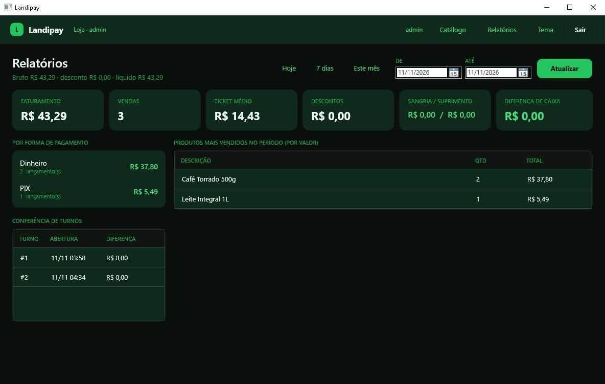

# 06 — Guia de operação

> Para quem usa a loja todos os dias e para quem dá suporte. Sem jargão de arquitetura:
> cada seção responde "o que eu faço" e "o que acontece se eu fizer".

---

## 1. Instalação

**Antes:** Windows 10/11, .NET 8 instalado, 200 MB livres.

```bash
# 1) backend (servidor da empresa) — uma vez
export LANDIPAY_ADMIN_KEY="<chave forte, guardada fora do repositório>"
dotnet run --project src/Landipay.Api          # http://127.0.0.1:5080

# 2) emitir a licença da loja (admin)
curl -X POST http://127.0.0.1:5080/v1/licencas \
  -H "Content-Type: application/json" -H "X-Admin-Key: <chave>" \
  -d '{"empresaId":"<guid da empresa>","instalacaoId":"loja-centro-01","plano":"pro"}'

# 3) no balcão
export LANDIPAY_CHAVE_LICENCA="<chave pública ES256>"
export LANDIPAY_API="http://<servidor>:5080"
dotnet run --project src/Landipay.Installer
```

O instalador **não pede administrador** e **não instala banco de dados**: ele cria a pasta
`%APPDATA%\Landipay`, aplica o schema, cadastra a empresa/loja, valida a licença e cria o
administrador — nessa ordem, cinco passos.

Reinstalar é seguro: ele detecta a instalação, carrega os dados na tela e atualiza o que existe.

---

## 2. Primeiro acesso

1. Abra o Landipay. A tela mostra **Criar administrador** (só aparece quando não há usuário).
2. Login, senha (mínimo 10 caracteres) e confirmação.
3. Ao criar, o sistema já deixa **3 produtos de demonstração** no catálogo — apague-os no Catálogo quando começar a cadastrar os reais.

Não existe senha padrão de fábrica. Se a senha for perdida, o caminho é redefinir pelo
banco/procedimento de suporte — não há "senha master".

---

## 3. Operação diária

### 3.1 Abrir o turno
Informe o **valor inicial da gaveta** (fundo de troco) e clique **Abrir turno**.
O topo passa a mostrar `Turno #N aberto`. O valor de abertura entra na conferência do fechamento.

### 3.2 Vender
1. Bipe o código de barras ou digite o SKU e pressione **Enter** (ou **Adicionar**).
2. Repita para cada item. O item já entra com quantidade 1.
3. Clique na forma de pagamento: **Dinheiro**, **PIX** ou **Cartão**.
4. Clique **Finalizar**.

O que acontece ao finalizar (tudo dentro de uma transação):
- a venda recebe número e status **Finalizada**;
- o estoque do produto baixa (produtos rastreados);
- um evento `VendaFinalizada` entra na fila de sincronização (outbox);
- a ação é gravada na auditoria com operador, loja e horário.

Pagamento parcial: registre uma forma, depois outra — o botão **Finalizar** só libera quando o pago
cobre o total. Se pagar em dinheiro a mais, o **troco** aparece no rodapé.

### 3.3 Sangria e suprimento
- **Sangria**: dinheiro sai da gaveta (ex.: depósito no banco). Motivo é obrigatório.
- **Suprimento**: dinheiro entra (ex.: reforço de troco). Motivo é obrigatório.

Ambos entram na conferência do turno e no relatório do período.

### 3.4 Fechar o turno
1. Conte a gaveta.
2. Digite o valor contado no campo ao lado de **Fechar turno**.
3. Clique **Fechar turno**.

O sistema mostra `Turno fechado · N venda(s) · total · calculado · diferença`.
**A diferença não é corrigida: é registrada.** Se faltou R$ 8,90, o relatório vai mostrar −R$ 8,90
em vermelho — é exatamente o que a auditoria precisa enxergar.

### 3.5 Catálogo
Botão **Catálogo** na barra superior: cadastro de produtos, preço, estoque e código de barras.
Produto inativo não pode ser vendido.

---

## 4. Relatórios

Botão **Relatórios** na barra superior. Escolha o período em **Hoje / 7 dias / Este mês** ou digite
**DE** e **ATÉ** e clique **Atualizar**.

| Indicador | O que significa |
|---|---|
| Faturamento | soma do **líquido** das vendas finalizadas (já com desconto) |
| Vendas | quantidade finalizada · canceladas aparecem ao lado |
| Ticket médio | líquido ÷ vendas finalizadas |
| Descontos | soma dos descontos concedidos no período |
| Sangria / Suprimento | dinheiro que saiu / entrou da gaveta |
| Diferença de caixa | soma das diferenças de conferência dos turnos do período |
| Por forma de pagamento | quanto entrou em cada forma e em quantos lançamentos |
| Produtos mais vendidos | top 10 por **valor** (não por quantidade) |
| Conferência de turnos | abertura, valores e diferença de cada turno |

Regras que evitam susto:
- Venda **cancelada** não entra no faturamento (aparece na contagem de canceladas).
- O período é por data local do fechamento da venda; o dia **ATÉ** entra inteiro.
- Relatório é somente leitura: nada aqui altera venda, turno ou estoque.



---

## 5. Backup e restauração

**O que salvar:** a pasta `%APPDATA%\Landipay` inteira.

```powershell
# backup (com o Landipay FECHADO)
$origem  = "$env:APPDATA\Landipay"
$destino = "D:\backup-landipay-$(Get-Date -Format yyyyMMdd-HHmm)"
Copy-Item $origem $destino -Recurse
```

Restaurar: feche o Landipay, substitua a pasta pelo backup, abra.

> O banco é SQLite com WAL: existem `landipay.db`, `landipay.db-wal` e `landipay.db-shm`.
> **Copie sempre os três juntos e com o app fechado** — copiar o `.db` sozinho com o app aberto
> pode perder as últimas vendas que ainda estão no WAL.

Frequência sugerida: diária no fechamento do turno (pendrive ou pasta de rede). Não há backup
automático — é decisão consciente desta versão.

---

## 6. Logs, privacidade e suporte

- **Log local sempre ativo** em `%APPDATA%\Landipay\logs\` (um arquivo por dia, 30 dias).
- **Nada é enviado para fora** sem consentimento explícito gravado no banco.
- **Suporte remoto** é por sessão: o atendente gera um código de 6 dígitos, válido por 30 minutos
  e de uso único; a sessão é encerrada e auditada. Não existe senha fixa nem acesso permanente.

LGPD na prática: os dados da loja ficam na loja; o relatório de suporte só sai com autorização
registrada; a auditoria guarda quem fez o quê e quando.

---

## 7. Aparência

Botão **Tema** alterna escuro ↔ claro **sem reiniciar** e sem perder o que está na tela.
A preferência fica salva por usuário. O tema escuro é o padrão.

---

## 8. Variáveis de ambiente

| Variável | Onde | Para quê |
|---|---|---|
| `LANDIPAY_DADOS` | cliente, instalador | pasta de dados alternativa (suporte, testes, perfil paralelo) |
| `LANDIPAY_API` | instalador | URL do backend (consulta de CNPJ) |
| `LANDIPAY_CHAVE_LICENCA` | instalador | chave pública ES256 para validar licença offline |
| `LANDIPAY_LICENCA` | instalador | token já preenchido (provisionamento em lote) |
| `LANDIPAY_ADMIN_KEY` | servidor | chave administrativa da API (obrigatória fora de Development) |
| `LANDIPAY_API_DB` | servidor | connection string do banco do backend |
| `LANDIPAY_CHAVES` | servidor | pasta das chaves ES256/Ed25519 |

---

## 9. Solução de problemas

| Sintoma | Causa provável | O que fazer |
|---|---|---|
| "Autenticação do operador…" e não entra | senha errada ou usuário bloqueado por tentativas | aguarde o tempo do bloqueio (5 min após 5 falhas, 30 min após 10) ou redefina a senha |
| "Não há turno aberto" | tentou vender com o caixa fechado | abra o turno com o valor inicial |
| Item não é encontrado ao bipar | produto sem código de barras ou inativo | cadastre/ative no Catálogo; use o SKU |
| Licença recusada na instalação | token de outra empresa, expirado, ou chave pública errada | confira a empresa licenciada e a data; reemita a licença |
| Instalador diz "sem permissão de escrita" | pasta de dados protegida | rode como o usuário dono da máquina ou defina `LANDIPAY_DADOS` para uma pasta gravável |
| Consulta de CNPJ falha | backend offline ou cadastro público fora do ar | preencha manualmente — o passo não bloqueia |
| Relatório vazio | período sem venda finalizada (ou data trocada) | confira DE/ATÉ; use "Este mês" |
| Diferença de caixa negativa | falta dinheiro na gaveta | não é erro do sistema: confira sangrias e troco; o valor fica registrado |
| App não abre | instância anterior travada ou banco em uso | encerre o processo `Landipay.Desktop` e abra de novo |

---

## 10. Checklist

**Diário (abertura)** — abrir turno com o fundo de troco · conferir se a data/hora do PC estão certas.

**Diário (fechamento)** — contar a gaveta · fechar o turno · conferir a diferença · copiar o backup ·
rodar o relatório do dia.

**Semanal** — revisar produtos sem giro · conferir estoque físico × sistema · olhar cancelamentos.

**Mensal** — relatório "Este mês" · conferir validade da licença · revisar quem tem login de administrador.
