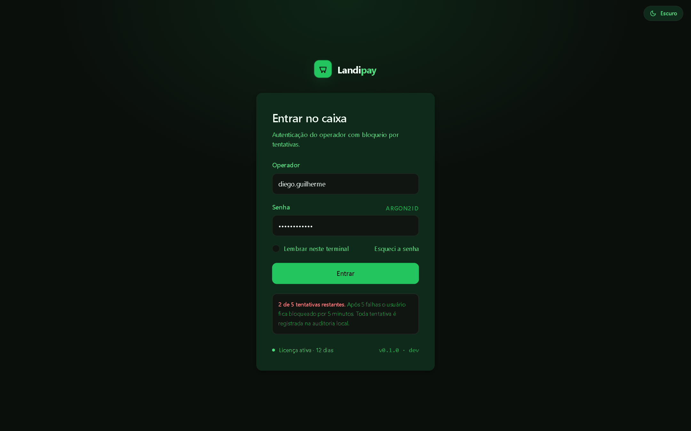
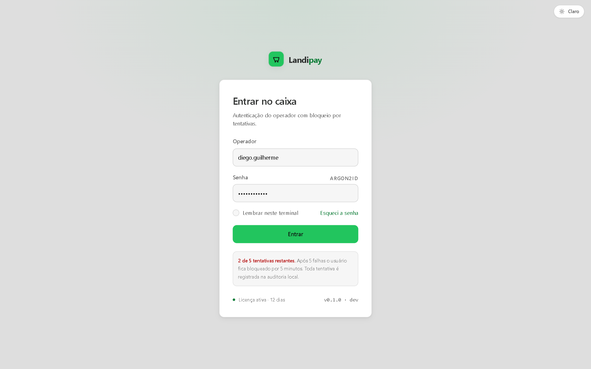
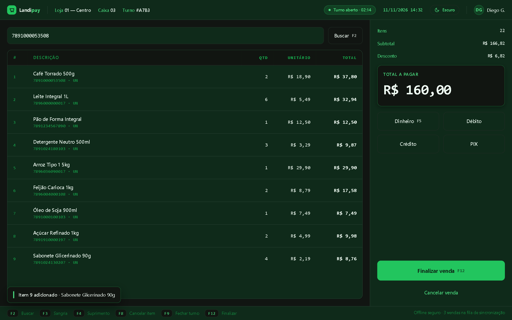
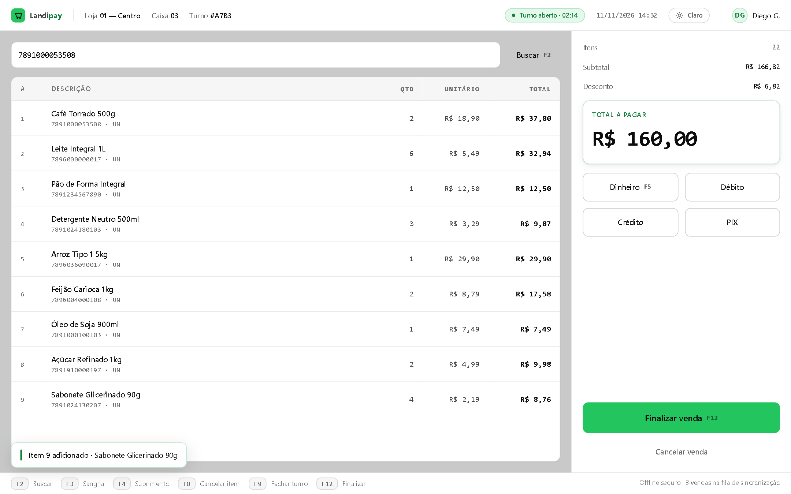
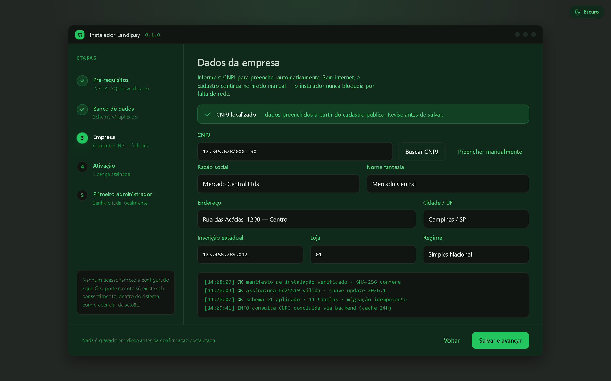
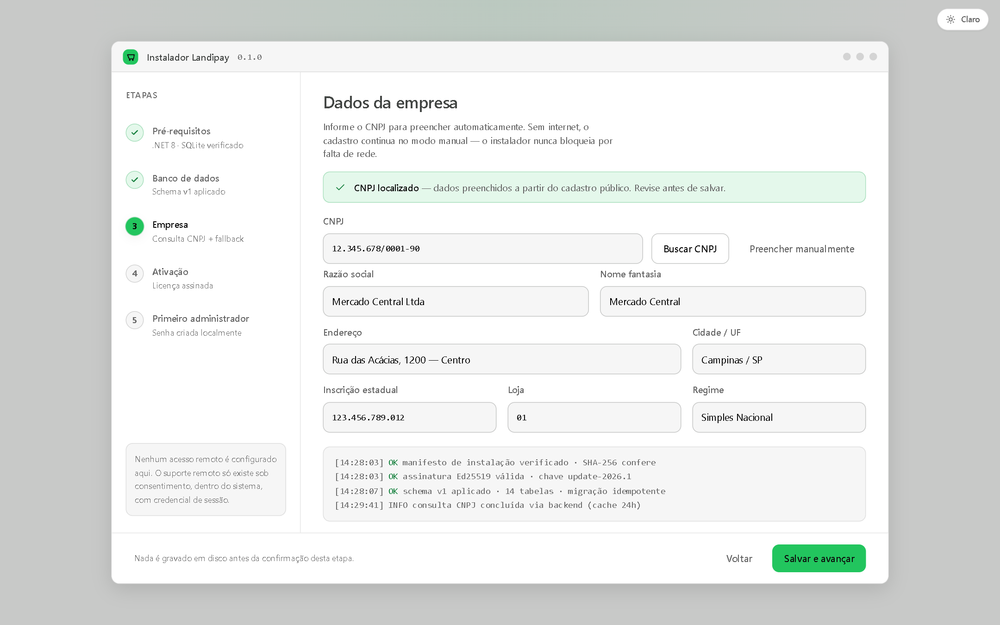

# 07 — Design System Landipay

> Documento da Fase 0 — **revisão 2 (pós-GATE 1)**. Estado: aguardando revalidação do GATE 1.
> Artefatos vivos: `design/tokens.json` (fonte de verdade, v0.2.0), `docs/mockups/tokens.css` (derivação web, 2 temas), `docs/mockups/*.html` + `*.png` (6 telas renderizadas + 3 comparações).
> Equivalente .NET na Fase 3: `Theme.Dark.xaml` e `Theme.Light.xaml`, ambos mapeando **as mesmas chaves**.

---

## 1. Modelo de temas

> **Modo escuro como padrão; modo claro disponível como opção, alternável nas configurações do app e do instalador. Ambos os temas compartilham o mesmo conjunto de tokens semânticos; nenhum componente pode referenciar cor concreta, apenas tokens.**

O tema claro **não substitui** o escuro — coexiste. A paleta preto/verde continua sendo a identidade do Landipay; o tema claro apenas inverte a luminância do fundo, mantendo o verde como cor primária.

### 1.1 Princípios (válidos nos dois temas)

1. **Verde é ação, não decoração.** Preenchimento de ação primária, estado ativo, foco. Fora isso, verde é acento pontual.
2. **Um token, um significado.** Componente consome token semântico; hex existe só na definição do token.
3. **Contraste medido, não estimado.** Toda combinação texto/fundo tem razão calculada e registrada na seção 6.
4. **Densidade de caixa.** Tipografia 13–14px, alvo ≥ 44px, números em monolargura tabular.
5. **Foco sempre visível.** Anel de 2px na cor de foco do tema, com offset de 2px.
6. **Superfície comunica hierarquia.** No escuro, o cartão é verde-escuro sobre página quase preta. No claro, o cartão é branco sobre página cinza, com sombra curta.

### 1.2 Hierarquia de superfícies do tema claro (inspirada no Square POS)

O tema claro segue a lógica de camadas do Square POS, e **apenas** ela:

- fundo de página `#F6F6F6` — cinza, não branco puro, para reduzir ofuscamento em turno longo;
- cartões e painéis em `#FFFFFF` — o conteúdo “flutua” sem precisar de borda pesada;
- bordas `#E3E3E3` — separação discreta, sem fadiga;
- distinção de elevação por **sombra curta**, não por cor (`bg-surface-elevated` é o mesmo `#FFFFFF`, com `--shadow-md`).

**O que não é copiado do Square:** paleta, azuis, tipografia, espaçamentos, componentes. A cor primária permanece o verde Landipay (`#22C55E`) e o sistema de espaçamento/raios/tipografia é o do Landipay. O Square entra como referência de *hierarquia de superfícies em tema claro*, nada além.

---

## 2. Tokens semânticos — tema escuro (padrão)

| Token semântico | Valor | Papel |
|---|---|---|
| `bg-page` | `#0B0F0C` | Fundo da janela |
| `bg-surface` | `#0F2A1A` | Cartões, painéis, topbar, trilha do instalador |
| `bg-surface-elevated` | `#111511` | Superfície acima do cartão (modal, toast, bloco de total) |
| `bg-inset` * | `#111511` | Campos, console, atalhos, cabeçalho de tabela |
| `text-primary` | `#F0FDF4` | Texto principal e valores |
| `text-secondary` | `#4ADE80` | Rótulos, texto de apoio, texto de passo ativo |
| `text-muted` | `#16A34A` | Legendas, metadados, placeholder |
| `border` | `#0F2A1A` | Borda padrão de cartão |
| `border-strong` * | `#1E2B22` | Borda de controle (input, botão secundário) |
| `divider` * | `color-mix(#F0FDF4 9%)` | Divisores internos (linha de tabela, topbar) |
| `primary` | `#22C55E` | Preenchimento de ação primária, marca |
| `primary-hover` | `#16A34A` | Hover do primário |
| `primary-foreground` * | `#0B0F0C` | Texto sobre o primário |
| `primary-on-surface` | `#4ADE80` | Verde como **texto/ícone** sobre superfície |
| `focus-ring` | `#4ADE80` | Anel de foco |
| `error` | `#F87171` | Erro |
| `success` | `#4ADE80` | Sucesso |
| `warning` * | `#F59E0B` | Alerta |

## 3. Tokens semânticos — tema claro (opção)

| Token semântico | Valor | Papel |
|---|---|---|
| `bg-page` | `#F6F6F6` | Fundo da janela (cinza, não branco) |
| `bg-surface` | `#FFFFFF` | Cartões, painéis |
| `bg-surface-elevated` | `#FFFFFF` | Igual ao cartão, **distinguido por sombra** |
| `bg-inset` * | `#F6F6F6` | Campos, console |
| `text-primary` | `#0D0D0D` | Texto principal |
| `text-secondary` | `#666666` | Rótulos, apoio |
| `text-muted` | `#6E6E6E` | Legendas (4.72:1 na página) |
| `border` | `#E3E3E3` | Borda padrão |
| `border-strong` * | `#D4D4D4` | Borda de controle |
| `divider` * | `color-mix(#0D0D0D 10%)` | Divisores internos |
| `primary` | `#22C55E` | **Somente preenchimento** e gráficos grandes |
| `primary-hover` | `#16A34A` | Hover do primário |
| `primary-foreground` * | `#0D0D0D` | Texto sobre o primário (8.53:1) |
| `primary-on-surface` | `#15803D` | Verde como **texto/ícone** sobre claro |
| `focus-ring` | `#16A34A` | Anel de foco (3.05:1 — atende 1.4.11) |
| `error` | `#B91C1C` | Erro |
| `success` | `#15803D` | Sucesso |
| `warning` * | `#B45309` | Alerta |

`*` = **token de extensão**: não estava na tabela da especificação, foi necessário para o sistema funcionar nos dois temas. Todos declarados em `design/tokens.json` com `"extension": true`.

**Regra explícita:** componentes **só consomem tokens semânticos**. Cores hexadecimais concretas aparecem apenas na definição dos tokens (`tokens.css` / `Theme.*.xaml` / `tokens.json`). Verificação automatizada na seção 8.

### 3.1 Por que `divider` foi criado

Na tabela especificada, `border` no escuro é `#0F2A1A` — **exatamente o mesmo valor de `bg-surface`**. Um divisor desenhado com `border` dentro de um cartão tem contraste **1.00:1**, ou seja, é invisível. Em vez de mudar o token `border` (que é contrato da especificação) ou espalhar hex, foi criado `divider` derivado de `text-primary` com 9–10% de alfa: inverte sozinho em cada tema e mantém a regra de token único.

---

## 4. Tipografia

**Família:** Inter (fallback Manrope → Segoe UI → system-ui). **Mono:** JetBrains Mono (fallback Cascadia Mono).

| Token | Tamanho | Peso | Uso |
|---|---|---|---|
| `display` | 32px | 700 | Total a pagar no PDV |
| `h1` | 24px | 600 | Título de tela / etapa |
| `h2` | 20px | 700 | Wordmark |
| `body` | 14px | 400/500 | Texto e linhas de tabela |
| `sm` | 13px | 500 | Rótulos de campo |
| `xs` | 12px | 600 | Caps labels, chips, legendas |
| `mono` | 12.5px | 400 | Hash, log, código de barras, atalhos |

Valores monetários sempre em mono com `tabular-nums` (WPF: `Typography.NumeralAlignment="Tabular"`). Caps labels só em `xs/600` com tracking `0.08em`.

---

## 5. Espaçamento, raios e elevação

**Base 4px:** `4, 8, 12, 16, 20, 24, 32, 40`. Sem valor fora da escala.

**Raios (8–12px, conforme identidade):** `sm 8` (kbd, checkbox), `md 10` (botão, input, toast), `lg 12` (cartão, painel, janela), `pill 999` (chip, avatar).

**Sombras — mudam por tema, o que muda é o peso, não o papel:**

| Token | Escuro | Claro |
|---|---|---|
| `shadow-sm` | `0 1px 2px rgba(0,0,0,.40)` | `0 1px 2px rgba(0,0,0,.06)` |
| `shadow-md` | `0 4px 12px rgba(0,0,0,.35)` | `0 1px 3px rgba(0,0,0,.08), 0 4px 12px rgba(0,0,0,.06)` |
| `shadow-lg` | `0 12px 32px rgba(0,0,0,.45)` | `0 8px 28px rgba(0,0,0,.12)` |

No claro a sombra é o que separa cartão de página; no escuro a separação é feita pela cor da superfície e a sombra apenas ancora o objeto.

---

## 6. Contraste e acessibilidade

Modelo: **WCAG 2.1** — texto normal 4.5:1, texto grande (≥18.66px bold ou ≥24px) 3:1, componentes não textuais 3:1 (1.4.11). Todos os valores abaixo foram **calculados** por script sobre os hex reais (luminância relativa sRGB), não estimados.

### 6.1 Tema escuro — pares principais

| Combinação | Razão | AA texto | Veredito |
|---|---|---|---|
| `text-primary` `#F0FDF4` / `bg-page` | **18.44:1** | 4.5 | ✅ Aprovado |
| `text-primary` / `bg-surface` | **14.68:1** | 4.5 | ✅ Aprovado |
| `text-secondary` `#4ADE80` / `bg-page` | **11.08:1** | 4.5 | ✅ Aprovado |
| `text-secondary` / `bg-surface` | **8.82:1** | 4.5 | ✅ Aprovado |
| `text-muted` `#16A34A` / `bg-page` | **5.86:1** | 4.5 | ✅ Aprovado |
| `text-muted` / `bg-surface` | **4.66:1** | 4.5 | ✅ Aprovado (limite) |
| `error` `#F87171` / `bg-page` | **6.98:1** | 4.5 | ✅ Aprovado |
| `error` / `bg-surface` | **5.56:1** | 4.5 | ✅ Aprovado |
| `primary` `#22C55E` / `bg-page` (texto/ícone) | **8.47:1** | 4.5 | ✅ Aprovado |
| `primary-foreground` `#0B0F0C` / `primary` | **8.47:1** | 4.5 | ✅ Aprovado |
| `focus-ring` `#4ADE80` / `bg-page` | **11.08:1** | 3 (1.4.11) | ✅ Aprovado |

**No escuro, o verde acento `#4ADE80` continua válido para texto sobre fundo escuro** — é o que a tabela acima comprova.

### 6.2 Tema claro — pares principais

| Combinação | Razão | AA | Veredito |
|---|---|---|---|
| `text-primary` `#0D0D0D` / `bg-page` | **17.98:1** | 4.5 | ✅ Aprovado |
| `text-primary` / `bg-surface` | **19.44:1** | 4.5 | ✅ Aprovado |
| `text-secondary` `#666666` / `bg-page` | **5.31:1** | 4.5 | ✅ Aprovado |
| `text-secondary` / `bg-surface` | **5.74:1** | 4.5 | ✅ Aprovado |
| `text-muted` `#6E6E6E` / `bg-page` | **4.72:1** | 4.5 | ✅ Aprovado |
| `text-muted` / `bg-surface` | **5.10:1** | 4.5 | ✅ Aprovado |
| `primary-on-surface` `#15803D` / `bg-page` | **4.64:1** | 4.5 | ✅ Aprovado |
| `primary-on-surface` / `bg-surface` | **5.02:1** | 4.5 | ✅ Aprovado |
| `error` `#B91C1C` / `bg-page` | **5.99:1** | 4.5 | ✅ Aprovado |
| `error` / `bg-surface` | **6.47:1** | 4.5 | ✅ Aprovado |
| `primary` `#22C55E` / `bg-page` (como texto/ícone) | **2.11:1** | 4.5 | ❌ **Reprovado** |
| `primary-foreground` `#0D0D0D` / `primary` `#22C55E` | **8.53:1** | 4.5 | ✅ Aprovado |
| `focus-ring` `#16A34A` / `bg-page` | **3.05:1** | 3 (1.4.11) | ✅ Aprovado (não-texto) |

### 6.3 Regra de uso do verde no tema claro (obrigatória)

O verde `#22C55E` sobre fundo branco tem **2.11:1** — reprova WCAG AA para texto. Portanto, **no tema claro**:

- `#22C55E` **só** pode ser usado como **preenchimento de botão** (com rótulo `primary-foreground = #0D0D0D`, 8.53:1) ou em **elementos gráficos grandes / ícones decorativos**;
- **texto e ícones verdes sobre superfície clara devem usar `primary-on-surface = #15803D`** (4.64:1 na página, 5.02:1 no cartão);
- **estado de foco usa `#16A34A`** (3.05:1, atende 1.4.11 para componentes não textuais);
- ícone verde de status (ex.: check de sucesso) usa `success = #15803D`, nunca `#22C55E`.

### 6.4 Dois pontos corrigidos após medição (decisões C1 e C2)

A especificação original pedia `#FFFFFF` sobre `#22C55E` no botão e `#8A8A8A` para texto terciário. Medidos, ambos reprovavam AA. Decisão tomada e aplicada:

| # | Item | Valor pedido | Medido | **Decisão aplicada** | Resultado |
|---|---|---|---|---|---|
| C1 | Texto do botão no claro | `#FFFFFF` sobre `#22C55E` | 2.28:1 | **`primary-foreground = #0D0D0D`** | **8.53:1** ✅ |
| C2 | `text-muted` no claro | `#8A8A8A` | 3.19:1 página / 3.45:1 cartão | **`#6E6E6E`** | **4.72:1 / 5.10:1** ✅ |

**Por que C1 foi resolvido pelo rótulo e não pelo preenchimento:** o preenchimento `#22C55E` é o token `primary` — a cor de marca. Escurecer o botão para `#15803D` resolveria o contraste mas quebraria a identidade e criaria um segundo "verde de ação". Trocando só o rótulo, o botão primário fica **igual nos dois temas** (verde cheio + texto quase preto), o que elimina uma divergência entre temas e mantém a marca intacta.

Os mockups foram re-renderizados com os dois ajustes (ver §10).

### 6.5 Nunca cor como único canal

Erro = cor + ícone + texto. Passo ativo = preenchimento + sombra + numeração. Seleção = fundo + barra lateral. Bordas de controle não atingem 3:1 (são decorativas por decisão); a identificação do campo vem do preenchimento distinto **mais** rótulo sempre visível, nunca do contorno isolado.

---

## 7. Componentes-base

Cada componente consome **apenas tokens**; o comportamento visual muda por tema sem nenhuma regra específica de tema no componente.

| Componente | Escuro | Claro | Regra invariante |
|---|---|---|---|
| **Button primary** | fundo `primary`, texto `primary-foreground` (#0B0F0C) | fundo `primary`, texto `primary-foreground` (#0D0D0D) | 1 por tela; hover `primary-hover`; foco 2px `focus-ring` + offset 2; **rótulo escuro nos dois temas** |
| **Button secondary** | transparente, texto `text-primary`, borda `border-strong` | idem | hover: borda accent-soft + fundo accent-soft |
| **Button ghost** | texto `text-secondary` | texto `text-secondary` | hover: `text-primary` + `bg-inset` |
| **Input** | fundo `bg-inset`, borda `border-strong` | fundo `bg-inset` (#F6F6F6), borda `border-strong` (#D4D4D4) | rótulo sempre visível; foco = borda `primary` + halo accent-soft; erro = `error` + ícone + texto |
| **Table** | cabeçalho `bg-inset`, linhas separadas por `divider` | idem | números à direita em mono; hover `bg-inset`; sem zebra |
| **Chip/badge** | fundo `accent-soft`, texto `primary-on-surface`, dot `success` | idem (texto #15803D) | estado vivo sempre com dot |
| **Card** | `bg-surface` + `shadow-md` | `bg-surface` (#FFF) + `shadow-md` | raio `lg`, borda `border` |
| **Modal/toast** | `bg-surface-elevated` + `shadow-lg` | `bg-surface-elevated` (#FFF) + `shadow-lg` | esc fecha; foco preso |
| **Stepper** | bullet ativo `primary` + `shadow-accent` | idem | ativo = cor + preenchimento + sombra |
| **KPI / total** | `bg-surface-elevated`, label `primary-on-surface`, valor `display` mono | idem | único bloco grande de verde da tela |
| **Theme toggle** | pill `bg-surface`, ícone lua, texto `text-secondary` | ícone sol | foco visível; persiste a escolha |

Alturas: 40px padrão, 48px barra de comando, 52–56px ações de caixa. Alvo mínimo 44×44px.

---

## 8. Implementação e alternância de tema

```
design/tokens.json            ← fonte única (2 temas, mesmas chaves)
        │
        ├── docs/mockups/tokens.css                      ← web: [data-theme="dark"|"light"]
        └── src/Landipay.Desktop/Themes/
                ├── Theme.Dark.xaml     ← mesmas chaves, valores do tema escuro
                └── Theme.Light.xaml    ← mesmas chaves, valores do tema claro
```

### 8.1 Mecânica (WPF; idêntico em Avalonia)

- Um `ResourceDictionary` de **tokens** (`Theme.Dark.xaml` / `Theme.Light.xaml`) é trocado no `Application.Resources.MergedDictionaries` em tempo de execução; os dicionários de **estilo** não são trocados — eles só referenciam `{DynamicResource Lp.*}`.
- Não há reinício: a troca reavalia todas as referências `DynamicResource` (por isso `StaticResource` é proibido para cor em estilo de componente).
- Chaves: `Lp.Bg.Page`, `Lp.Bg.Surface`, `Lp.Bg.SurfaceElevated`, `Lp.Text.Primary`, `Lp.Text.Secondary`, `Lp.Text.Muted`, `Lp.Border`, `Lp.Border.Strong`, `Lp.Divider`, `Lp.Primary`, `Lp.Primary.Hover`, `Lp.Primary.Foreground`, `Lp.Primary.OnSurface`, `Lp.FocusRing`, `Lp.Error`, `Lp.Success`, `Lp.Warning`.
- Mesma nomenclatura semântica do CSS (`--text-primary` ↔ `Lp.Text.Primary`), mapeada 1:1 a partir de `tokens.json`.

### 8.2 Persistência

- Preferência **por usuário/perfil** (`%APPDATA%\Landipay\preferences.json`), nunca por máquina — dois operadores no mesmo terminal podem preferir temas diferentes, e o perfil é o que define a sessão.
- Padrão quando não há preferência salva: **escuro**.
- O **instalador** respeita a preferência do usuário que está instalando (lê o mesmo arquivo se existir; senão escuro) e oferece o alternador na própria UI.
- A troca **não exige reinício** (mockups demonstram: o atributo `data-theme` troca tudo em runtime, sem recarregar).

### 8.3 Proibição de cor hardcoded — verificável

- Web/mockups: `grep -E '#[0-9a-fA-F]{3,8}' docs/mockups/*.html` deve retornar **nada**.
- WPF (Fase 3): passo de CI que falha o build se houver `#RRGGBB` em `.xaml` fora de `Theme.Dark.xaml` / `Theme.Light.xaml`.

---

## 9. O que não mudou nesta revisão

Stack, arquitetura, modelo de ameaças, comparativo A1–A6, nome, paleta verde, tipografia geométrica, raios 8–12px, ícones lineares e o fato de o **escuro ser o padrão**. A revisão acrescenta um segundo tema e uma regra de contraste; não reescreve a identidade.

---

## 10. Mockups

Provas renderizadas em navegador real (1440×900, escala 1.5) — os dois temas vêm do **mesmo HTML**, trocados por token, o que é a demonstração prática da regra “nenhum componente referencia cor concreta”.

### 10.1 Login

| Escuro (padrão) | Claro (Square-like) |
|---|---|
|  |  |

### 10.2 Frente de caixa

| Escuro (padrão) | Claro (Square-like) |
|---|---|
|  |  |

### 10.3 Instalador — etapa “Empresa”

| Escuro (padrão) | Claro (Square-like) |
|---|---|
|  |  |

Comparações lado a lado (escuro | claro): `mockups/login-compare.png`, `mockups/pdv-compare.png`, `mockups/installer-compare.png` (4320×1350).

**O que a versão clara demonstra:** página `#F6F6F6`, cartões brancos, bordas `#E3E3E3`, botão primário verde, texto secundário `#666`, foco no verde escuro `#16A34A`, e texto verde sempre em `#15803D` (nunca `#22C55E`).

**Correções registradas nesta revisão:**
- alternador de tema no PDV estava flutuando sobre o botão “Buscar” → movido para dentro da topbar;
- no instalador escuro, o conteúdo ficou preto sobre moldura verde e os campos sumiram → a janela passou a `bg-surface`, com `titlebar` em `bg-inset`;
- `border` no escuro é igual a `bg-surface` (divisores invisíveis) → criado `divider` derivado.

---

## 11. Do / Don't

| ✅ Faça | ❌ Não faça |
|---|---|
| Verde `#15803D` para texto no tema claro | `#22C55E` como texto sobre branco (2.11:1) |
| Um botão primário por tela | Três botões verdes competindo |
| Valor monetário em mono tabular à direita | Número proporcional dançando na coluna |
| Superfície diferente por tema | Hex dentro de componente |
| Alternador respeitando perfil do usuário | Tema por máquina (dois operadores, um terminal) |
| Verificar contraste por script no CI | “Parece legível o suficiente” |

---

## 12. Marca e ativos

As logos originais (PNG 1536×1024, fundo branco sólido) ficam fora do repositório, na pasta do
projeto. Os ativos usados pelo produto são **gerados** por `assets/gerar-assets.py`, para que a
derivação seja reproduzível e não dependa de recorte manual no Photoshop:

| Ativo | Origem | Uso |
|---|---|---|
| `app.ico` (16→256) | símbolo da logo minimalista | ícone do `.exe`, da janela, dos atalhos e do MSI |
| `icone-256.png` | idem | ícone em tamanho grande (base do `.ico`) |
| `logo-horizontal-escuro.png` | símbolo + wordmark | cabeçalho do cliente e do instalador no **tema escuro** |
| `logo-horizontal-claro.png` | idem, arte original | cabeçalho no **tema claro** |
| `logo-completa-escuro/claro.png` | logo com assinatura | tela de login |

### 12.1 Três decisões que o arquivo original não resolve

1. **Fundo branco não serve.** As duas artes vêm em RGB com fundo branco; num app escuro isso vira
   um retângulo branco. O script remove o branco por alpha calculado no canal mais alto
   (`0` em ~branco, `255` em cor) — preserva as cores da marca sem o "lavado" do unpremultiply.
2. **A marca tem duas cores e o produto tem dois temas.** O wordmark é `#0F3524` (verde escuro) e
   sobre `#0B0F0C` ele desaparece. Por isso existem as variantes *claro/escuro*, e a troca é por
   `DynamicResource`: a chave `Lp.Logo.Horizontal` existe nos dois dicionários, então alternar o
   tema troca a arte sem uma linha de código.
3. **O símbolo não sobrevive a 16px transparente.** O paralelogramo é verde-escuro e some em barra
   de tarefas escura (medido: 16/24/32px nos dois fundos). O ícone ganha **placa clara arredondada**
   (`#F0FDF4`, raio 22%) atrás do símbolo — passa a ler em qualquer tema do Windows.

### 12.2 Regras de uso

- A logo **não** é decorativa: aparece no cabeçalho (identidade) e no login (boas-vindas). Não se
  repete em cada tela.
- Nunca recolorir o wordmark para o verde primário: `landipay` tem `landi` escuro e `pay` verde —
  a divisão faz parte da marca.
- Ícone sempre quadrado, com margem interna; não esticar a logo horizontal em caixa quadrada.
- Ao trocar a arte oficial, rode `python assets/gerar-assets.py` — não edite os PNGs à mão.

Arquivos gerados em `src/Landipay.Theme/Assets/` e embarcados como `Resource` do assembly do tema,
servidos por `pack://application:,,,/Landipay.Theme;component/Assets/...` para cliente e instalador.

---

## 13. Changelog

| Versão | Data | Mudança |
|---|---|---|
| 0.1.0 | 11/11/2026 | Criação: paleta única escura, 10 componentes, 3 mockups, contraste medido. `text-muted` corrigido de `#6B7A70` (4.27:1) para `#85948A`. |
| 0.2.0 | 11/11/2026 | **Dois temas** sobre as mesmas chaves; tabelas de tokens escuro e claro; regra de uso do verde no claro; seção de contraste com 23 pares medidos; alternância via `ResourceDictionary` com persistência por usuário; token de extensão `divider`; 6 telas renderizadas + 3 comparações; 2 conflitos de contraste registrados como decisão pendente (C1 botão, C2 `text-muted`). |
| 0.2.1 | 11/11/2026 | Correções C1 e C2 aprovadas e aplicadas: `primary-foreground` claro `#FFFFFF` → `#0D0D0D` (2.28:1 → 8.53:1); `text-muted` claro `#8A8A8A` → `#6E6E6E` (3.19:1 → 4.72:1). Mockups re-renderizados. Nenhum par de contraste reprova AA. |
| 0.3.0 | 11/11/2026 | **Marca aplicada**: ativos derivados das logos oficiais por `assets/gerar-assets.py` (branco→transparente, variantes por tema, `.ico` multi-tamanho com placa clara). Logo no cabeçalho do cliente e do instalador, logo completa no login, ícone em executáveis, atalhos e MSI. Seção 12. |


---

## Atualização — Componentes e telas da separação

**Estado:** aplicado no binário; mockups capturados em escuro e claro.

### Componentes novos

| Componente | Uso | Tokens |
|---|---|---|
| `AcessoNegadoView` | operação barrada em sessão válida | `Lp.Brush.Error`, `Lp.Brush.AccentSoft`, `Lp.Brush.Inset` |
| Cartão de seleção de app (instalador) | passo 6 | `Lp.Card`, `Lp.Body`, `Lp.Brush.Divider` |
| `Badge` de escopo (`ADMIN` / `CAIXA`) | cabeçalho dos apps | `Lp.Brush.AccentSoft`, `Lp.Caps` |

Nenhum hex novo: as telas novas consomem apenas tokens semânticos, então a troca de tema continua
funcionando sem reiniciar — comprovado alternando o tema com as telas abertas.

### Diferença entre os apps

Os dois usam o mesmo design system e a mesma logo; o que muda é **o que existe na tela**:

- Admin: barra com `Início · Catálogo · Relatórios` + badge `ADMIN`.
- Caixa: barra apenas com `Tema · Sair` + badge `CAIXA`.

Não há "modo reduzido" nem item desabilitado: o item de menu **não existe** no outro executável, e
o serviço nega mesmo que alguém tente chamá-lo.

### Tema no instalador

O instalador ganhou o botão `Tema` no cabeçalho (canto direito, antes da versão), seguindo o mesmo
contrato: troca de `MergedDictionaries[0]` em tempo real, sem reiniciar.
